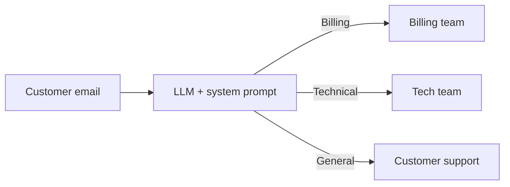
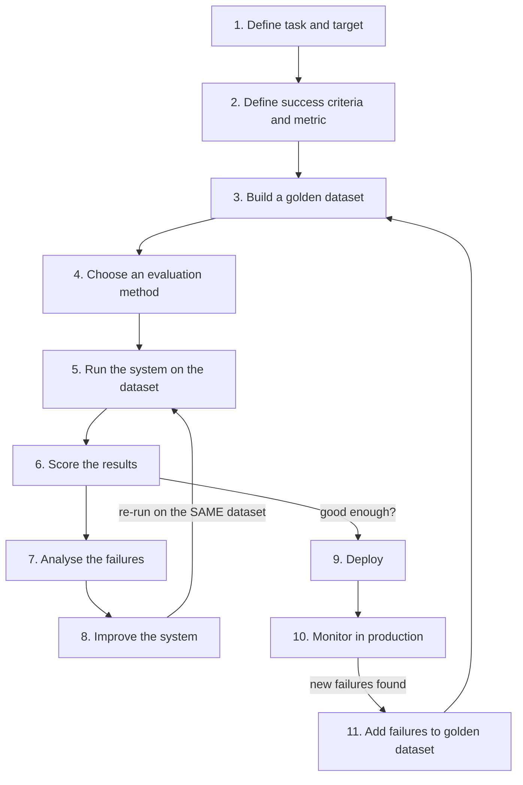

# Lecture 3 — The LLM Application Evaluation Workflow

> **Source lecture:** [How to Evaluate LLM Applications: The Complete Workflow](https://www.youtube.com/watch?v=Pv4mkG2K_s8) (CampusX)
> **What this note adds:** plain-language explanations, worked numbers, diagrams, the "accuracy trap", and extra best practices from outside the lecture (marked 🔎 *Beyond the lecture*).

---

## 0. Where this fits

| Lecture | Question it answers |
|---|---|
| 1 | **Why** do we need evals? (Vibe testing is dangerous.) |
| 2 | **What** are evals? (Systematic, repeatable tests against clear criteria. Model evals vs application evals.) |
| **3 (this)** | **How** do we actually evaluate an LLM *application*, step by step? |

> The workflow in this lecture is the **master recipe** for the whole course. The same steps get reused for RAG chatbots, agents and safety testing. Only the metrics and datasets change.

---

## 1. The running example: an email router for Zomato

### The business problem
Zomato (a big food-delivery company) receives **thousands of customer emails every day**. Someone has to read each one and forward it to the right team. That's slow, boring and expensive.

### The LLM solution
Put an LLM in the middle with a **system prompt** like:

> "You are a customer-support agent. Read the email and classify it as **Billing**, **Technical** or **General**."



- **System prompt**: the hidden instruction you give the LLM before the user's text. It sets the LLM's job, rules and tone.
- This app takes about 5–10 minutes to build. That's the trap: because it's easy to build, people deploy it **without testing**.

> **Golden rule:** never deploy an LLM app directly. **Evaluate first.**

---

## 2. The workflow at a glance



Two loops are hidden in this picture:
1. **Inner loop (before launch):** run → score → analyse → improve → run again.
2. **Outer loop (after launch):** monitor → find new failures → add them to the dataset → re-evaluate.

---

## 3. The steps in detail

### Step 1: Define the task and the target
- **Target** = *what* are you testing? It could be the whole app, a single component (e.g. a retriever) or a workflow.
- **Task** = *what should it do correctly?*
- Email router: **target** = the whole routing workflow. **Task** = classify each email into the correct category.

> 💡 **Analogy:** before a driving test you decide *what* is being tested (parking? highway driving?). You don't just "see how it goes".

### Step 2: Define the success criteria and the metric
- **Success criterion** = what "good" means in words: *"emails go to the right team."*
- **Metric** = the number that measures it: **accuracy**.

**Accuracy** = correct predictions ÷ total predictions.
*Example:* 90 of 100 emails routed correctly gives 90/100 = **90% accuracy**.

#### 🔎 Beyond the lecture: the accuracy trap
Accuracy can **lie** when the categories are unbalanced.

| Scenario | Data | Model behaviour | Accuracy |
|---|---|---|---|
| Lazy model | 90 General, 5 Billing, 5 Technical | Always answers "General" | **90%**, yet it never routes a single billing email correctly |

So for classification tasks, also look at:
- **Per-class precision**: of the emails the model labelled "Billing", how many really were billing?
- **Per-class recall**: of the real billing emails, how many did the model catch?
- **Confusion matrix**: a table of *true category* vs *predicted category*. It shows exactly which categories get mixed up (e.g. Billing ↔ Technical).

```
                    Predicted
               Billing  Tech  General
Actual Billing    40      8      2     ← 8 billing emails sent to Tech!
       Tech        3     45      2
       General     1      2     97
```

This table tells you **where** to improve. Here the prompt clearly needs to separate Billing from Technical better.

### Step 3: Build a dataset (the golden dataset)
A **golden dataset** is a set of test inputs together with the **known correct answers** (labels). It's called "golden" because it is your trusted reference: the answer key.

| Email text | Correct label |
|---|---|
| "My card was charged twice." | Billing |
| "The app crashes on login." | Technical |
| "What are your opening hours?" | General |

- **Size:** typically **50–500 rows** to start.
- **Best source:** **real past emails/chats**, so the test reflects reality.
- **Labelling:** done **manually by people** who know the business.

🔎 *Beyond the lecture: what makes a good golden dataset*
1. **Representative**: the same mix of categories and difficulty as real traffic.
2. **Covers edge cases**: very short emails, emails covering two topics ("I was double-charged AND the app crashed"), angry emails, other languages.
3. **Unambiguous labels**: if two people would label an email differently, either fix the label rules or drop the example.
4. **Kept separate from prompt tuning.** If you tweak the prompt while staring at the same 50 examples, you may "overfit" the prompt to them. Keep a held-out set you look at less often.
5. **Versioned**: keep a record of which dataset version produced which score.

### Step 4: Choose the evaluation method (who does the scoring?)

| Method | Who scores | Best for | Downside |
|---|---|---|---|
| **Automated / programmatic** | Code (e.g. a Python script) | Exact or simple answers (labels, numbers) | Can't judge open-ended text |
| **Human** | A person | Nuanced, subjective judgments | Slow and costly at scale |
| **LLM-as-a-judge** | Another LLM | Long free-text answers (chatbots) | Can itself be wrong or biased; needs checking |

- **Email router:** the output is just a label, so **a simple Python comparison** is enough. Paying a human, or calling another LLM, would be a waste.
- **Chatbot:** "expected answer = a paragraph, actual answer = a paragraph". Code can't easily tell whether two paragraphs *mean* the same thing, so you need a human or an LLM judge.

### Step 5: Run the system
Send every golden-dataset input through your app and record its outputs.

### Step 6: Score the results
Compare outputs with the correct labels → e.g. **80% accuracy** (80 right, 20 wrong).

### Step 7: Analyse the results (error analysis)
Look at the **20 wrong ones**. Why did they fail? Common causes:
- **The system prompt is unclear**, e.g. it never explains the difference between Billing and Technical.
- **The model is too weak**, e.g. a small open-source model.
- The dataset label itself is wrong (it happens!).

🔎 *Beyond the lecture:* a practical method is to **read the failures one by one, write a short note on each ("confused refund with tech issue"), then group the notes into categories** and fix the biggest group first. Practitioners such as Hamel Husain and Shreya Shankar describe this as "open coding" followed by "axial coding".

### Step 8: Improve the system
In the lecture's story:

| Iteration | Change | Accuracy |
|---|---|---|
| v1 | Simple prompt | 80% |
| v2 | Better prompt | 90% |
| v3 | Bigger LLM | 95% ✅ manager happy |

> Note: the lecture slide said "improve the **model**". The instructor corrected it: improve the **system**, which covers the prompt, the model, the data pipeline and so on.

### Step 9: Iterate on the SAME dataset
This is why evals must be **repeatable**. Every change is tested on the same golden set, so the scores are comparable. It's like weighing yourself on the same scale every day, instead of a different scale each time.

### Step 10: Deploy, then monitor
95% on your test set ≠ 95% in the real world. Real users send emails you never imagined.

### Step 11: Feed production failures back
When a real email is misrouted, **add it (with the correct label) to the golden dataset**. Over time the dataset becomes richer and closer to reality.

**Who notices production failures?** Build a **process**. In the example, the Tech team receives a billing email, the customer says "this is about billing", and the Tech team **flags** it. Flagged cases flow into the dataset.

---

## 4. One app, many evals (the key takeaway)
> **A single LLM application usually has several evaluation pipelines.**

For a RAG chatbot you might run separate evals for:
- the **retriever** (does it find the right documents?)
- the **embedding model**
- the **whole RAG pipeline** (are the answers good?)
- **latency / cost** (is it fast and cheap enough?)

Lecture 4 explains *why* in detail.

---

## 5. Common mistakes to avoid
| Mistake | Why it hurts | Fix |
|---|---|---|
| Testing with 5 hand-picked questions | That's vibe testing; not representative | 50–500 real, labelled examples |
| Changing the dataset between runs | Scores become incomparable | Freeze and version the dataset |
| Only tracking accuracy | Hides class-level failures | Per-class metrics + confusion matrix |
| Stopping after launch | Real traffic differs from tests | Monitor and feed failures back |
| Improving only "the model" | The prompt and pipeline matter just as much | Treat the whole *system* as the target |

---

## 6. Quick revision
- **Golden dataset** = inputs + trusted correct answers.
- **Eval method** = who scores: code, human, or LLM-as-a-judge.
- **Workflow** = define → criteria → dataset → method → run → score → analyse → improve → repeat → deploy → monitor → feed back.
- **Repeatability** is what lets you compare v1 vs v2 fairly.
- **Many evals per app** is normal.

### Self-test
1. Why was a Python script enough for the email router, but not for a chatbot?
2. A model gets 92% accuracy, but 90% of your emails are "General". Why might it still be bad?
3. What two things happen after deployment in this workflow?

<details><summary>Answers</summary>

1. The output is a fixed label, so exact comparison works. Chatbot answers are free text, and judging whether two texts mean the same thing needs a human or an LLM.
2. It might be mostly predicting "General". Check per-class recall and the confusion matrix.
3. Monitoring, and adding production failures back into the golden dataset.
</details>
