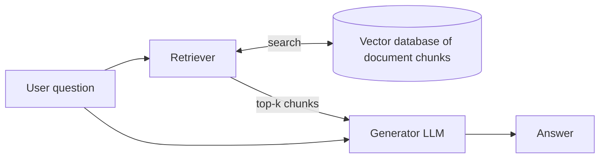
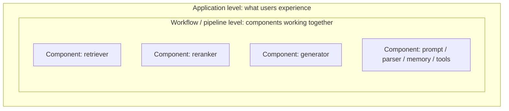

# Lecture 4 — Why Every LLM App Needs Multiple Eval Pipelines

> **Source lecture:** [Why Your AI Application Needs Multiple Eval Pipelines?](https://www.youtube.com/watch?v=DcZ-XCk-O_M) (CampusX)
> **What this note adds:** simple explanations of RAG, a worked failure example, the software-testing analogy, research on "lost in the middle", and a mapping to the OWASP LLM risk list (🔎 *Beyond the lecture*).

---

## 1. The big idea in one sentence
> An LLM app needs **more than one** evaluation pipeline because (1) it can **break in many places**, and (2) each place can fail in **many different ways** (quality, safety, cost/speed).

An **evaluation pipeline** is one complete test setup (dataset + metric + method) focused on one thing, e.g. "is the retriever finding the right documents?"

---

## 2. Quick primer: what is a RAG chatbot?
**RAG = Retrieval-Augmented Generation.** Instead of answering from memory alone, the LLM first **looks things up** in your own documents.

> 💡 **Analogy:** an open-book exam. The **retriever** is the student flipping through the textbook to find the right pages. The **generator** is the student writing the answer using those pages.

Key terms:
- **Chunk**: a small piece of a document (e.g. a few paragraphs).
- **Vector database**: stores chunks as lists of numbers (vectors) so that similar meanings can be found quickly.
- **Embedding model**: converts text into those vectors.
- **k (top-k)**: how many chunks the retriever brings back (e.g. k = 5).

---

## 3. Reason 1: there are multiple failure points

### 3.1 Obvious failure points
| Component | How it fails | Result |
|---|---|---|
| **Retriever** | Brings the wrong chunks | Generator answers from wrong information |
| **Generator** | Ignores good chunks, makes things up (hallucination) | Wrong answer despite good context |

So you add **one eval per component**:
- **Retriever eval:** for a question, were the *relevant* chunks retrieved?
- **Generator eval:** is the answer **faithful (grounded)** to the given chunks, with no invented facts?
  - *Example:* the chunk says "ML course = 3 weeks". A faithful answer says exactly that. An unfaithful answer adds "…and the Python course is 4 weeks, also great!" when no chunk said so.

### 3.2 The surprise: both parts "pass" but the app still fails
Setup: **k = 5**, no reranker. Question: *"What is the duration of the ML course?"*

| Rank | Chunk content |
|---|---|
| D1 | Something unrelated |
| D2 | Something unrelated |
| D3 | "Python course is **6 weeks**" |
| D4 | Something unrelated |
| D5 | "ML course is **8 weeks**" ✅ |

- **Did the retriever succeed?** Yes. Its job was "get the right info somewhere in the top 5", and D5 has it.
- The generator's prompt prioritises **higher-ranked** chunks, so it picks D3 and answers **"6 weeks"** ❌.
- **Did the generator do anything "wrong" by its own rules?** Not really. It didn't invent anything; it used a provided chunk and followed its instructions.

➡️ **Each component looks fine in isolation, but their *interaction* fails.** You therefore need a **workflow/pipeline-level eval** that tests the retriever and generator *together*.

**The fix in the lecture:** add a **reranker**. It is a second model that re-orders the retrieved chunks by how well each one matches the question, so D5 moves to the top.

🔎 *Beyond the lecture: research backs this up.* The paper **"Lost in the Middle: How Language Models Use Long Contexts"** (Liu et al., 2023; TACL 2024) found that LLMs use information best when it sits at the **beginning or end** of the context, and worse when it's buried in the **middle**. [arXiv:2307.03172](https://arxiv.org/abs/2307.03172). **Chunk order matters**, which is exactly why rerankers help.

### 3.3 Even then: application-level failures
Retriever ✅, generator ✅, pipeline ✅, but **every answer takes 10 seconds**. Users won't wait. You need **application-level evals** such as latency below a threshold.

### 3.4 The three levels of failure

| Level | What can fail | Examples |
|---|---|---|
| **Component** | One part | System prompt. RAG: retriever, reranker, query rewriter, embedding model, vector DB. Structured output: output parser. Agents: tool selector, memory, guardrails. |
| **Workflow** | How parts interact | RAG flow, an agent's multi-step flow, a multi-turn chat flow |
| **Application** | The whole product | Total latency, cost per query, **time to first token (TTFT)**: how long until the first word appears |

🔎 *Beyond the lecture: the software-testing analogy*

| Software testing | LLM eval equivalent |
|---|---|
| **Unit test**: one function | Component eval (retriever alone) |
| **Integration test**: modules together | Pipeline eval (retriever + generator) |
| **System / end-to-end test**: the whole app | Application eval (quality, safety, latency) |

> 💡 **Analogy:** a car's engine and brakes might each pass a factory test, but you still need a **road test** of the whole car.

---

## 4. Reason 2: there are multiple risk categories
Each failure point can fail in **different ways**.

| Level | Quality risk | Another risk at the same level |
|---|---|---|
| Application | Answer must be correct and helpful | **Safety**: must not reveal another user's phone or email |
| Workflow | Answer must be faithful/grounded | **Cost**: must not cost more than a threshold |
| Component | Retriever must fetch the right docs | **Latency**: must not take 5–10 seconds |

### 4.1 The three risk categories

| Category | Question it answers | Plain meaning |
|---|---|---|
| **Application quality** | Does the app do its job well? | Correct, relevant, complete answers |
| **Safety** | Can it cause harm? | Toxic, dangerous, biased, leaking private data, jailbreakable |
| **Operations** | Can it run **fast, cheap and reliably**? | Latency, cost, errors |

### 4.2 Risk-category cheat sheet

**Quality, by app type**

| App type | Risks to measure | Plain-English meaning |
|---|---|---|
| General LLM app (e.g. a summarizer) | Correctness, relevance, completeness, **instruction following** | Is it right? On-topic? Covers everything? Follows format/length rules? |
| RAG | **Context relevance**, **retriever recall**, **groundedness/faithfulness**, **citation accuracy** | Good chunks fetched? None missed? Answer only from chunks? Correct sources cited? |
| Agents | **Tool selection**, **parameter correctness**, **task completion**, **error recovery** | Right tool? Right inputs to the tool? Finished the job? Recovered from mistakes? |
| Multi-turn chatbot | **Context retention**, **clarification behaviour** | Remembers earlier messages? Asks when confused? |

**Safety**

| Risk | Meaning |
|---|---|
| Toxicity | Rude, abusive, hateful language |
| Harmful content | Self-harm, weapons, illegal acts |
| Bias | Treats users differently by gender, background, etc. |
| **PII leakage** | Reveals **Personally Identifiable Information** (phone numbers, cards, addresses) |
| Prompt injection / jailbreak | Tricked into breaking its rules |

**Operations**

| Risk | Meaning |
|---|---|
| Latency | How long users wait |
| Cost per request | Money spent per answer |
| Token efficiency | Not wasting tokens (tokens ≈ pieces of words the LLM reads/writes, which you pay for) |
| Error/failure rate | How often it crashes or times out |
| Latency under load | Speed when many users arrive at once |

🔎 *Beyond the lecture: the industry safety checklist.* The **OWASP Top 10 for LLM Applications (2025)** is a widely used list of LLM security risks. It includes Prompt Injection (LLM01), Sensitive Information Disclosure (LLM02), Supply Chain (LLM03), Data and Model Poisoning, Improper Output Handling, Excessive Agency, **System Prompt Leakage** (new in 2025), **Vector and Embedding Weaknesses** (new), Misinformation, and Unbounded Consumption. [OWASP GenAI announcement](https://genai.owasp.org/2024/11/17/owasp-reveals-2025-top-10-risks-for-llms-new-sponsorship-program/). Lecture 16 uses several of these.

---

## 5. Putting it together: the eval matrix
Think of evals as a **grid**: *levels* (rows) × *risk categories* (columns).

| | Quality | Safety | Operations |
|---|---|---|---|
| **Component** | Retriever recall/precision, generator faithfulness | e.g. retrieved chunks containing PII | Retriever latency |
| **Pipeline** | RAG triad (context relevance, faithfulness, answer relevance) | Prompt injection via documents | Pipeline cost |
| **Application** | Correctness, completeness, style | Toxicity, leakage, scope | End-to-end latency, cost/query, reliability |

Each filled cell can be its own pipeline. That's why **~99.99% of LLM apps have more than one eval**.

---

## 6. Quick revision
- Failures happen at three **levels**: component, workflow, application.
- Each level has three **risk categories**: quality, safety, operations.
- Components can pass individually while the **pipeline fails** (the ranking problem), so test the interaction too.
- A **reranker** fixes "right chunk buried at the bottom".

### Self-test
1. In the ML-course example, why did neither component technically fail?
2. Name one safety and one operations risk for the **component** level.
3. What does TTFT measure, and why do users care?

Answers

1. The retriever got the correct chunk inside its top-5 budget. The generator followed its rule of prioritising top chunks and invented nothing. The failure came from their interaction.
2. Safety: a retrieved chunk containing PII. Operations: retriever latency.
3. Time to first token: how long until the first word appears. Users perceive a fast start as responsiveness.

