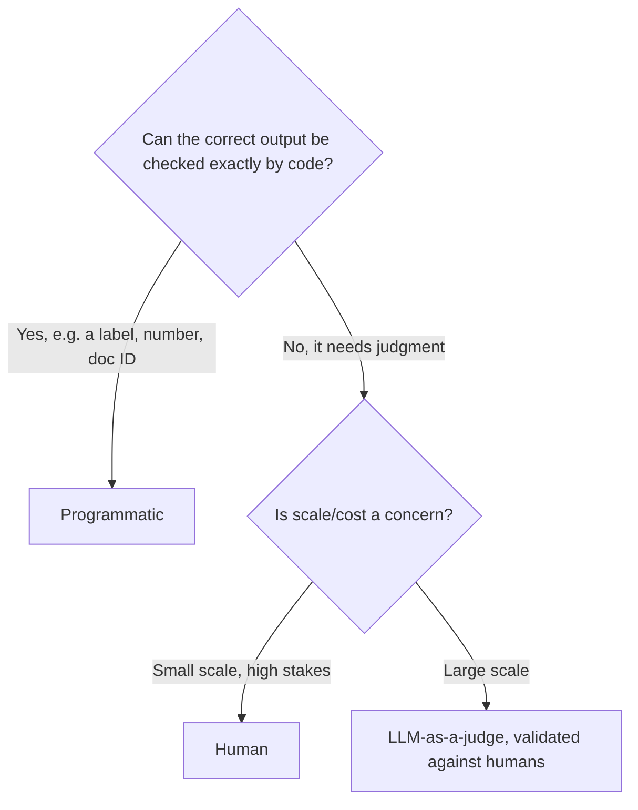
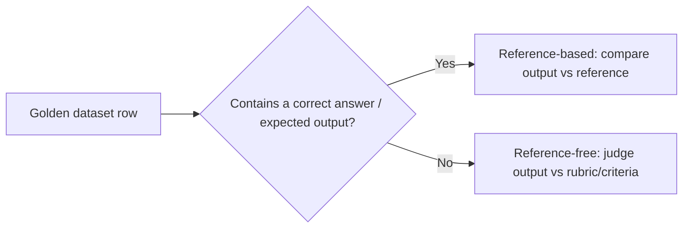

# Lecture 5 — Eval Methods: Programmatic, Human, LLM-as-a-Judge · Reference-Based vs Reference-Free

> **Source lecture:** [LLM Eval Methods | LLM-as-a-Judge | Reference Based vs Reference Free Evals](https://www.youtube.com/watch?v=uQFLY8rQVYA) (CampusX)
> **What this note adds:** worked calculations, more retrieval metrics (precision@k, MRR), human-agreement statistics, known LLM-judge biases from research, and judge-validation tips (🔎 *Beyond the lecture*).

---

## 1. What is an "eval method"?
> **Definition:** an eval method is the *mechanism* that takes an LLM's output and produces a **judgment** about it (good/bad, a score, pass/fail).

Put simply: **who (or what) actually does the grading?**

| Method | The grader | Analogy |
|---|---|---|
| **Programmatic (deterministic)** | Code | An MCQ answer sheet checked by a machine |
| **Human** | People | A teacher marking an essay |
| **Model-graded (LLM-as-a-judge)** | Another LLM | A teaching assistant marking essays using the teacher's rubric |

> ⚠️ The method is about who **runs/executes** the evaluation. Building the golden dataset is a separate job, usually done by humans, even when a program does the scoring.

---

## 2. Example 1: programmatic eval (evaluating a retriever)

### Setup
A RAG chatbot for CampusX. We test **only the retriever**, a **component-level** eval.

### Metric: Recall@k
> **Recall@k** = (correct documents found in the top-k results) ÷ (all correct documents that exist)

*Plain meaning:* "Of everything the retriever *should* have found, how much did it actually find in its top k?"

**Worked example.** Question: *"What are the prerequisites for the ML course, and how long is it?"*
- Correct docs (decided by a human expert): **{1001, 1003}**
- Retrieved with k = 5: **{1001, 1002, 1004, 1005, 1006}**
- Found correct docs: just 1001, so **1** of the **2**.
- **Recall@5 = 1/2 = 50%**

Recall ranges from 0% to 100%. Ideally it's 100%.

### The process
1. **Golden dataset:** 50–100 realistic questions (easy, hard, edge cases). For each, a human marks which document IDs contain the answer.
2. **Run** each question through the **retriever only** (not the full chatbot).
3. **Score per question** (Q1 = 1.0, Q2 = 0.5, …), then **average**. E.g. dataset Recall@5 = **67%**.
4. **Analyse** the worst questions and **improve** the retriever:

| Improvement | Plain meaning |
|---|---|
| Better **embedding model** | Better "meaning-to-numbers" converter, so better matches |
| **Query expansion** | An LLM rewrites/expands the question first (adds synonyms, details) |
| Increase **k** | Fetch more docs (5 → 10). Recall usually goes up. |
| Add a **reranker** | Re-sorts results so a relevant doc at rank 8 moves up to rank 3 |

No human is needed to *run* this. Code compares ID lists.

### "Relevance" has more than one aspect (from the student Q&A)
1. **Of all the correct docs, how many did you fetch?** That's **recall**.
2. **Of the docs you fetched, how many were useful?** That's **precision**.
3. **Were the useful ones ranked near the top?** That's a **ranking** metric.

🔎 *Beyond the lecture: three common retrieval metrics*

| Metric | Formula (simple) | Example (same case as above) |
|---|---|---|
| **Precision@k** | correct found in top k ÷ k | 1 correct out of 5 retrieved = **0.20** |
| **Recall@k** | correct found in top k ÷ total correct | 1 of 2 = **0.50** |
| **MRR** (Mean Reciprocal Rank) | 1 ÷ (rank of the *first* correct doc), averaged over questions | First correct at rank 1 gives 1/1 = **1.0** |

There is also **nDCG**, which gives more credit to relevant documents near the top and supports graded (not just yes/no) relevance.

---

## 3. Example 2: human eval (chatbot helpfulness)

### Setup
A general CampusX chatbot ("When is the next course?", "Fee?", "Certificate?"). We test the **whole application** on **quality only**, specifically **helpfulness** = accurate + right tone + complete.

### Why there's no simple metric
"Helpfulness" depends on the business, so we define a **rubric**: a scoring guide that describes what each score means.

| Score | Meaning |
|---|---|
| **5** | Correct, accurate, complete, perfect tone |
| **3** | Partially helpful |
| **1** | Not helpful / off-topic |

### Dataset
50–100 questions, **one column only (the question)**. No correct answer is stored.
*e.g.* "How long is the ML course?", "Is the ML course right for me if I know Python?", "Do I get a refund if I drop out?", "Can I pay in instalments?"

### Process
For each question: the chatbot answers, then a human reads the question and answer and gives a 1–5 score using the rubric. Average all the scores to get the **helpfulness score**.

### Why use two or more graders?
If Grader A says 2 and Grader B says 4, again and again, **the rubric is probably ambiguous**. Use the disagreements to **rewrite the rubric** until graders agree.

🔎 *Beyond the lecture: measuring agreement.* Teams often compute **Cohen's kappa (κ)**, a number from −1 to 1 that measures agreement *beyond chance*. Roughly, κ > 0.6 is considered substantial agreement. Low κ means the rubric needs work.

### Five ways humans contribute to evaluation

| Way | What it is | Example |
|---|---|---|
| 1. **Direct grading / rating** | Score outputs with a rubric | The helpfulness study above |
| 2. **Red teaming** | Humans deliberately try to *break* the system | Testers trying to make a model reveal secrets before launch |
| 3. **A/B testing** | Real users try two versions; the better-rated one wins | 50% of users get bot v1, 50% get v2 |
| 4. **Golden dataset + rubric creation** | Writing the answer keys and scoring guides | An expert labelling which document answers each question |
| 5. **Human-in-the-loop** | Hard or grey-area cases are escalated to a person | The LLM judge is unsure, so a human decides |

| Human evaluation | |
|---|---|
| ✅ Pro | Reliable, trusted judgment; handles nuance |
| ❌ Con | **Expensive and slow**. Impossible for millions of conversations. |

---

## 4. Example 3: LLM-as-a-judge (the UPSC answer grader)

### Background
**UPSC** is India's civil-services exam: **Prelims** (multiple choice, easy to auto-grade), **Mains** (written essays, needs expert graders) and an **Interview**. A mock-test platform with 10,000+ students can't afford enough experts to mark the Mains essays.

A vendor offers an **LLM that grades essays using your rubric** for a fraction of the cost. **Our job is to evaluate that grader before trusting it.**

### Step by step
1. **Target / task:** does the LLM grade the way **human experts** grade?
2. **Success criterion:** LLM marks ≈ human marks.
3. **Rubric per question**, written by an expert. For *"Ethical governance is impossible without administrative accountability. Discuss." (15 marks)*, a good answer:
   - explains ethical governance **and** accountability
   - explains the **link** between them
   - gives **mechanisms** (e.g. RTI, audits)
   - cites **examples**
   - has a **balanced conclusion**

   ⚠️ The rubric is **not** the dataset. It's the marking scheme.
4. **Golden dataset (50–100 student answers):** answer ID, question, the student's **full answer text**, and the **human expert's marks**.
   - e.g. all 5 rubric points covered = **13/15**; mostly missing = **4/15**.
5. **Method:** LLM. Code can't grade essays; humans are too expensive at scale.
6. **Judge prompt** (the core of it):
   > "You are grading a UPSC Mains answer against an evaluation rubric. [Question] [Marks] [Rubric] [Student answer]. For each dimension, decide whether the answer genuinely addresses it, then allocate marks. **Do not reward verbosity, keyword stuffing, or confident assertions that lack substantiation.** Reward structure, relevant examples and balanced argumentation. Return: dimensions addressed, total marks, a one-sentence justification."
7. **Compare the LLM's marks with the human marks** using **MAE (Mean Absolute Error)**.

### MAE, explained
> **MAE** = the average of |LLM mark − human mark| across all answers.

**Worked example** (4 answers):

| Answer | Human | LLM | \|difference\| |
|---|---|---|---|
| A1 | 13 | 12 | 1 |
| A2 | 4 | 8 | 4 |
| A3 | 8 | 8 | 0 |
| A4 | 10 | 14 | 4 |
| | | **MAE** | (1 + 4 + 0 + 4) / 4 = **2.25** |

*Meaning:* on average the LLM is about 2.25 marks off from the human. **Goal: MAE → 0.**

Ways to reduce MAE: a better LLM, a better prompt, a clearer rubric. Keep looping.

🔎 *Beyond the lecture: also check correlation and bias direction*
- **MAE** shows *how far off* the judge is, but not *which way*. Also compute the **mean signed error** (LLM − human). If it's positive, the judge is a **lenient** marker.
- **Correlation** (e.g. Spearman's ρ) tells you whether the judge **ranks** answers in the same order as humans, which matters if you're comparing students.

🔎 *Beyond the lecture: known biases of LLM judges.* Research has documented systematic judge biases:
- **Position bias**: in A-vs-B comparisons, preferring whichever answer is shown first.
- **Verbosity bias**: preferring longer answers.
- **Self-enhancement bias**: preferring text written by itself or similar models.

*Sources:* Zheng et al., "Judging LLM-as-a-Judge with MT-Bench and Chatbot Arena" (2023), [arXiv:2306.05685](https://arxiv.org/abs/2306.05685). The G-Eval paper also warns that LLM evaluators may prefer LLM-generated text over human-written text, [arXiv:2303.16634](https://arxiv.org/abs/2303.16634).

**Practical defences:**
- Swap the A/B order and average the two runs.
- Tell the judge not to reward length (the UPSC prompt does this ✅).
- Validate the judge against human labels (exactly the MAE step above ✅).

> Building an LLM app is the easy part. Making sure it works **every time, everywhere** is the hard part. That's the production-engineer mindset.

---

## 5. Reference-based vs reference-free evaluation

| | **Reference-based** | **Reference-free** |
|---|---|---|
| Definition | A known correct answer (or the key facts it must contain) is **written in advance** for each test case. You grade by **comparing** with it. | **No correct answer per item.** You judge the output **on its own** against criteria/a rubric. |
| Role of the rubric | — | A **general scoring standard**, not an answer key |
| Lecture examples | **Retriever eval** (correct doc IDs known). **UPSC grader** (human marks are the reference). | **Chatbot helpfulness** (questions only; the judge uses a rubric). |
| Other examples | Correctness vs a gold answer, exact-match QA | Toxicity, tone, "is the answer relevant to the question?" |
| Works in production? | Usually **no**: new user questions have no answer key | **Yes**: covered in lecture 6 |

> 🧪 **Quick test:** *does my golden dataset contain the correct answer?* Yes means reference-based. No means reference-free.

---

## 6. Summary table: the three methods side by side

| | Programmatic | Human | LLM-as-a-judge |
|---|---|---|---|
| Speed | ⚡ Fastest | 🐢 Slowest | ⚡ Fast |
| Cost | ~Free | 💰💰💰 | 💰 |
| Nuance | Low | Highest | High |
| Repeatability | Perfect | Varies by person | Varies run to run (lecture 15 fixes this with G-Eval) |
| Needs validation? | Rarely | Agreement checks | **Yes**: compare with humans |
| Example | Recall@k | Helpfulness rating | UPSC grading |

---

## 7. Coming next
Everything so far is **offline evaluation** (before deployment). Lecture 6 covers **online evaluation**, which happens after deployment on real traffic.

### Self-test
1. A retriever must find docs {7, 9, 12} and returns {7, 3, 12, 4, 5}. What are Recall@5 and Precision@5?
2. Is "score the chatbot's tone from 1 to 5" reference-based or reference-free?
3. Why did the UPSC prompt say "don't reward verbosity"?

Answers

1. Recall = 2/3 ≈ 0.67. Precision = 2/5 = 0.40.
2. Reference-free: there's no correct answer per item, only a rubric.
3. LLM judges tend to favour longer answers (verbosity bias), and students could pad answers to game the grader.

