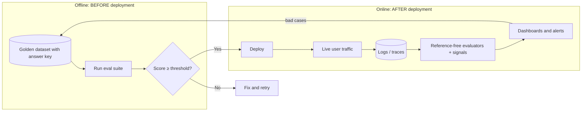
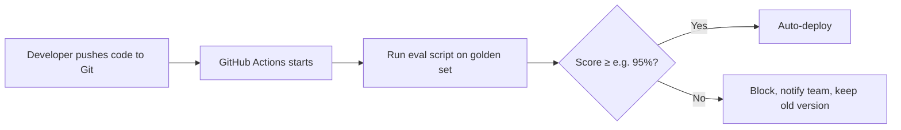
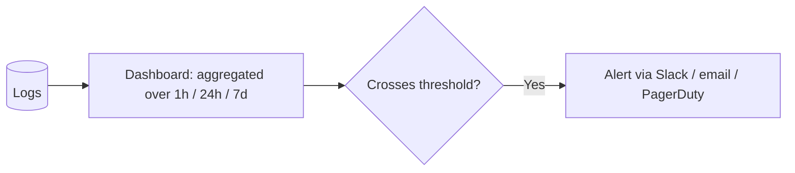
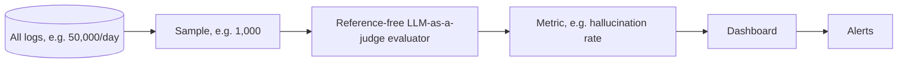
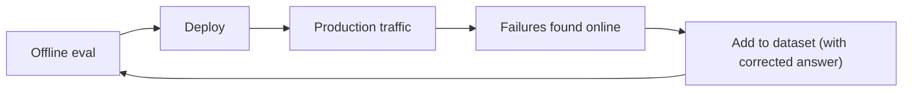

# Lecture 6 — Offline Evals vs Online Evals

> **Source lecture:** [Offline Evals Vs Online Evals](https://www.youtube.com/watch?v=SahaDGzN-Bk) (CampusX)
> **What this note adds:** diagrams of CI gating and the online pipeline, types of drift, how stratified sampling works, and how LangSmith automation rules actually filter and sample (🔎 *Beyond the lecture*). Corrections are marked ✏️.

---

## 1. The two kinds of evaluation in one picture



> **Offline evals check whether the app works *correctly*. Online evals check whether it's running *normally* in production.**

They are **partners, not rivals**. You always need both.

---

## 2. Offline evals

### Definition
> Any evaluation you run on your LLM app **before deploying it**, using a fixed **golden dataset** (usually with an answer key).

Everything in lectures 3–5 (email router, Recall@k, UPSC grader) was offline evaluation.

### Benefit 1: pre-release testing and release gates
You can automate the go/no-go decision with **CI/CD**:
- **Continuous Integration (CI)**: automatically test every code change.
- **Continuous Deployment (CD)**: automatically release it if the tests pass.



> 💡 **Analogy:** a factory quality gate. Every product passes inspection before it leaves the factory.

### Benefit 2: version comparison
Same eval + same dataset = a **level playing field**. You can compare:
- Claude vs OpenAI models
- prompt A vs prompt B
- reranker X vs Y
- vector database A vs B
- whole architectures

### Benefit 3: regression testing
**Regression** = a change improves one thing but **breaks something else**.

*Lecture example:* the CampusX chatbot sounded cold about refunds, so someone added "be very kind and polite" to the prompt. Now it's *too* soft and, to please users, says the Insider plan costs "around ₹19,000" instead of the true **₹19,500**. Tone improved; factual accuracy **regressed**.

**How offline evals catch it:**
- Make sure the golden set covers **every question type** (refunds, pricing, curriculum, …).
- Track scores **per category**:

| Category | Before | After prompt change | Verdict |
|---|---|---|---|
| Refund tone | 70% | 90% | ✅ Improved |
| Pricing accuracy | 90% | **80%** | ❌ Regression, so don't ship |

---

## 3. Why offline evals aren't enough: three production risks

| Risk | What happens | Example |
|---|---|---|
| **1. Unanticipated inputs** | Real users send things your 200–500 test questions never covered | Hinglish (Hindi + English), half-questions, angry rants, prompt injection attacks |
| **2. Emergent / systematic failures** | Problems that only appear **at scale** | Latency spikes when thousands of users arrive after a course launch. **Subtle bias** visible only across thousands of chats (e.g. worse answers for non-technical users). |
| **3. Drift** | The world changes and your test set becomes outdated | Prices, curricula and policies change, so the knowledge base changes, but the golden dataset still reflects last year. Offline scores look great; users complain. |

🔎 *Beyond the lecture: kinds of drift*

| Type | Meaning | Chatbot example |
|---|---|---|
| **Data (input) drift** | The *kind* of questions users ask changes | After a new course launches, most questions are about it |
| **Concept drift** | The *right answer* to the same question changes | "What's the fee?" had one correct answer last year and a different one now |
| **Model drift** | The LLM provider updates the model behind the same API name | Same prompt, slightly different behaviour |

> Offline evals need a golden dataset with correct answers. In production, new questions **have no answer key**, so offline evals alone can't cover these risks.

---

## 4. Online evals

### Definition
> **Online evaluation** = evaluating your system on **live production traffic after deployment**, as real users interact with it.

**The key property:** it works **without an answer key / golden dataset**.

### Offline vs online comparison

| | Offline | Online |
|---|---|---|
| When | Before deployment | After deployment, continuously |
| Data | Fixed golden dataset | Live traffic |
| Answer key | Usually yes | **No** |
| Inputs | Only what you **anticipated** | **Anything** |
| Catches | **Regressions** | **Drift**, surprises, emergent bugs |
| Best for | Release gating, version comparison, CI | Drift detection, real-world health |
| Cost and speed | Fast, cheap, repeatable | Can be expensive at scale, so you **sample** |

✏️ *Correction:* the lecture's sampling example mixes "500" and "50,000" conversations a day. The intended example is **sampling about 1,000 out of 50,000 daily conversations** (you can't sample 1,000 from 500).

---

## 5. Correctness vs normality (the core idea)

**UPSC grader example:**
- **Offline**, we measured **correctness**: how close the LLM's marks were to the **human expert's** marks.
- **Online**, a brand-new student answer has **never been graded by a human**, so correctness **can't be measured**.
- We **can** measure **normality**: is the grader behaving like it usually does?

**How:** plot the **distribution of scores** each week and compare with past weeks (the **baseline**).

```
Weeks 1–4 (baseline)          Week 5 (alert!)
count                          count
 |    ▆█▆                        |          ▆█▆
 |  ▃█████▃                      |        ▃█████▃
 |▁███████████▁                  |      ▁███████████▁
 +-------------- marks           +-------------- marks
  200  500  700                    200  500   800
```

The scores suddenly moved up. Either the students got smarter, or the **grader broke**. Either way, you **investigate**.

> Online evals usually can't prove correctness. They tell you whether **something changed**, which is your cue to look.

### Estimating quality without an answer key
1. **Use reference-free metrics.** *Example:* **faithfulness** needs only the retrieved context and the answer. Ask an LLM: "Is this answer supported by this context?"
2. **Use proxy signals.** *Example:* a **thumbs-up/thumbs-down** button. A spike in thumbs-down in the last hour probably means correctness has dropped.
3. **Compare against a baseline distribution** (the UPSC example above).

---

## 6. The online evaluation pipeline

### Step 1: Logging (the foundation)
> "Capture a **structured, replayable** record of every conversation turn."

If you don't record it, you can't evaluate it.

**What to log:**

| Group | Fields |
|---|---|
| IDs | conversation ID, turn ID, user ID, session ID, timestamp |
| Content | user question, **retrieved context**, model output |
| Operations | latency (ms), prompt tokens, completion tokens, total cost, errors and status codes |
| Behaviour | thumbs up/down, escalation ("connect me to a human"), repeated or rephrased questions |

**Tool example:** **LangSmith** (stores traces with inputs, outputs and metadata).

**Four properties of good logging:**
1. **Non-blocking**: logging runs in the background and must not slow down replies.
2. **Durable and queryable**: stored safely in a structured way so you can search it later (a data warehouse or observability tool).
3. **Late-signal attachment**: signals that arrive later (e.g. a complaint email the next day) are linked back via the **conversation ID**.
4. **PII handling**: **mask** personal data before storing it (phone, card number, address, date of birth, Aadhaar) so employees can't read it later. **PII = Personally Identifiable Information.**

### Step 2: Know your signals

| Type | Meaning | Examples |
|---|---|---|
| **Captured** | Already available; just store it | Thumbs up/down, latency, cost, token count |
| **Computed** | Must be calculated by an **online evaluator** | Faithfulness, answer relevance, hallucination, toxicity, bias |

### Pipeline A: captured signals



- **Dashboards** show **aggregates** over time windows. A single slow chat doesn't matter; a trend does.
- *Example:* a course launch brings 500 users at once, latency climbs, so you add servers (e.g. more AWS EC2 instances and load balancers).
- **Alerts:** nobody watches graphs 24/7. Alert when a metric crosses a threshold (e.g. latency > 4 s).

### Pipeline B: computed signals



**Why sample?** Running a judge LLM on every conversation can **more than double** your LLM bill.

**Random vs stratified sampling:**
- **Random**: pick 1,000 conversations at random.
- **Stratified (better)**: first **split conversations into groups**, then **sample more from risky groups**:
  - thumbs-down conversations
  - conversations that ended abruptly
  - escalations ("talk to a human")
  - repeated or rephrased questions (the user wasn't satisfied)
  - money topics (refunds, fees, admissions)
  - *fewer* from thumbs-up conversations (probably fine)
- Putting conversations into groups may itself need a small classifier model.

> 💡 **Analogy:** a food inspector doesn't test every meal. They test more often at the stalls with complaints.

🔎 *Beyond the lecture: how LangSmith does it.* In LangSmith, **automation rules** have a **filter** (which runs qualify), a **sampling rate** (what fraction of the filtered runs to process, e.g. 10% to control cost) and an **action** (e.g. run an LLM-as-judge evaluator). The API takes `sampling_rate` as a decimal from 0 to 1. [LangSmith docs: online evaluations](https://docs.langchain.com/langsmith/online-evaluations-llm-as-judge), [rules](https://docs.langchain.com/langsmith/rules). **Filter + sample** is a simple way to do stratified sampling: e.g. a rule for "thumbs-down runs at 100%" and another for "all runs at 5%".

### LangSmith evaluator templates seen in the demo
- **Security:** PII leakage, prompt injection, code injection
- **Safety:** toxicity, bias/fairness
- **Quality:** hallucination, correctness, conciseness, code checker
- **Agents:** trajectory (did the agent take sensible steps?)
- Most are **LLM-as-a-judge**. You configure the judge model, API key, temperature, prompt/rubric and output format.
- **Run on tracing → online evaluator. Run on a dataset → offline evaluator.**

---

## 7. Closing the loop: the self-improving cycle



In LangSmith, a bad trace can be sent to a dataset with **"Add to dataset"**, or to an **annotation queue** where a human marks what went right or wrong.

---

## 8. Q&A from the lecture

**"Dashboard shows faithfulness 0.87 and latency 3 s. Is the bot good?"**
Compare against a **baseline**, usually taken from offline evaluation. With a baseline of 0.85, 0.87 is fine. A drop to 0.75 in the last 24 hours is a warning: alert and fix.

**"Offline score rose from 92 to 99. Is that good for production?"**
It depends **which metric**, and whether **other metrics dropped**. One metric improving at the expense of others is a regression.

---

## 9. Quick revision
- **Offline** = before deploy, golden data, correctness, gating, regression testing.
- **Online** = after deploy, live data, no answer key, normality, drift detection.
- Online pipeline: **log → (sample → evaluate) → dashboard → alert**.
- **Stratified sampling** focuses evaluation money on risky conversations.
- Production failures are fed back into the offline dataset.

### Self-test
1. Why can't you measure correctness online for the UPSC grader?
2. Give one captured and one computed signal.
3. Why is stratified sampling better than random sampling for catching hallucinations?

<details><summary>Answers</summary>

1. There's no human-graded reference for the new answers.
2. Captured: latency or thumbs-down. Computed: faithfulness or toxicity.
3. It concentrates the samples in conversations most likely to contain problems (thumbs-down, escalations, money topics), so you find more failures for the same cost.
</details>
