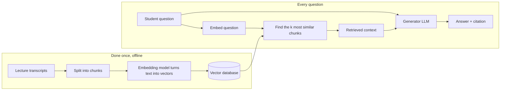
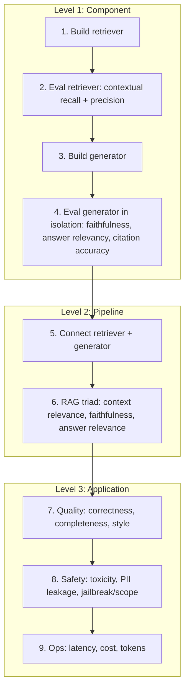
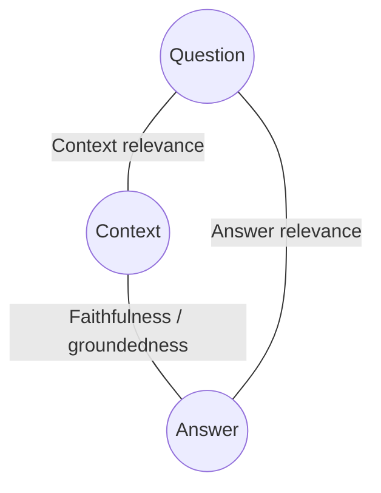
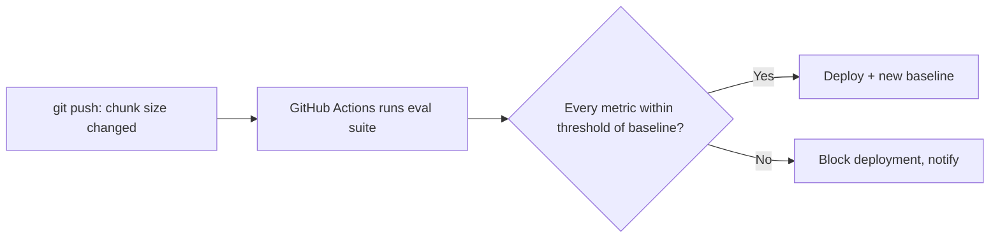

# Lecture 12 — The RAG Evaluation Framework ("How do you evaluate your RAG app?")

> **Source lecture:** [How to Answer "How Do You Evaluate Your RAG App?" in GenAI Interviews](https://www.youtube.com/watch?v=4zn-gSckVTQ) (CampusX)
> **What this note adds:** a beginner's RAG primer, every metric defined in plain words with DeepEval's official formulas, the testing-pyramid analogy, a RAGAS vs DeepEval comparison, and a polished interview answer (🔎 *Beyond the lecture*).

---

## 1. Why this lecture matters
"How do you evaluate your RAG chatbot?" comes up in roughly **8 out of 10 GenAI interviews** (the instructor's estimate). Most candidates either don't know, or list 3–4 metric names ("recall, precision, answer relevance…").

> A **framework** answer (levels → metrics → regression testing → online monitoring) shows real depth. This lecture gives you that framework; lectures 13–19 implement it.

### Course position
- ✅ Fundamentals (lectures 1–6)
- ✅ Model evals (benchmarks, leaderboards, custom model evals)
- ▶️ **Application evals**, starting here with **RAG**, then **agents**

LLM app types: simple chatbots, **RAG chatbots**, **agents**, multimodal apps (e.g. image generators), fixed-schema output apps (e.g. an email classifier). The course covers **RAG and agents**: they're the most common in production, and the simpler types follow from them.

---

## 2. RAG in plain language

> **RAG (Retrieval-Augmented Generation)** = "look it up, then answer". The LLM is given relevant pieces of *your* documents so it answers from them, not just from memory.



**Glossary**
| Term | Simple meaning |
|---|---|
| Chunk | A small piece of a document |
| Embedding | A list of numbers representing the meaning of text; similar meanings give similar numbers |
| Vector database | A database optimised to find "nearest" embeddings quickly (e.g. Chroma, Pinecone) |
| Retriever | The component that fetches the top-k relevant chunks |
| Reranker | An optional model that re-orders the retrieved chunks by relevance |
| Generator | The LLM that writes the answer using the question + chunks |
| Context | The chunks given to the generator |
| Hallucination | The LLM states something that isn't supported (made up) |

### The case study: CampusX Doubt Solver
- A simple **RAG chatbot** over the **transcripts of every lecture** in this course. Students ask doubts and it answers, **citing which session** covered the topic.
- It's deliberately simple, so the focus stays on **how to evaluate**.
- **Build and evaluate together**, just like software: test each function as you write it.

---

## 3. The eval suite: 3 levels, 9 steps



### Level 1: Component

**Retriever** (does it fetch the right chunks?)

| Metric | Plain meaning | Needs a reference? |
|---|---|---|
| **(Contextual) recall** | Of the information *needed* to answer, how much was retrieved? | ✅ Yes (an ideal answer) |
| **(Contextual) precision** | Of the chunks retrieved, how many are useful, and are the useful ones ranked at the top? | ✅ Yes |

**Generator, tested in isolation**: feed it **hand-picked correct context** (not the retriever's output), so retriever mistakes don't contaminate the result.

| Metric | Plain meaning |
|---|---|
| **Faithfulness** | Does the answer stick to the given context (no made-up facts)? |
| **Answer relevancy** | Does the answer actually address the question? |
| **Citation accuracy** | Does it cite the correct source (e.g. "Session 6, link…")? |

> 💡 **Why isolate?** If you test the generator with the retriever attached and the answer is bad, you can't tell *which* part is to blame. It's like testing a car's engine on a test bench instead of on a bumpy road.

### Level 2: Pipeline, the RAG triad
Three things exist in every RAG interaction: the **question**, the **context** and the **answer**. Each pair gives one metric.



| Pair | Metric | Question it answers |
|---|---|---|
| Question ↔ context | **Context relevance** | Is the retrieved context relevant to the question? |
| Context ↔ answer | **Faithfulness** | Is the answer grounded in the context? |
| Answer ↔ question | **Answer relevance** | Does the answer address the question? |

If all three are high, the pipeline is healthy. *(The "RAG triad" term was popularised by the TruLens project; DeepEval has a guide on it: [Using the RAG Triad](https://deepeval.com/guides/guides-rag-triad).)*

### Level 3: Application

| Step | Category | Metrics | Plain meaning |
|---|---|---|---|
| 7 | **Quality** | **Correctness** | Is the answer factually right? |
| | | **Completeness** | Are all parts of a multi-part question answered? |
| | | **Style** | Does it explain like a CampusX teacher (intuitive, conversational)? |
| 8 | **Safety** | **Toxicity** | No rude, insulting or demotivating language |
| | | **PII leakage** | Never reveals personal data |
| | | **Jailbreak / scope** | Can't be tricked into other tasks or rule-breaking |
| 9 | **Operations** | **Latency, cost per query, tokens** | Fast and affordable enough? |

> All of these together = the **eval suite**. Some evals need **golden datasets** (reference-based); some don't (reference-free).

🔎 *Beyond the lecture: official DeepEval formulas* (all are LLM-judged ratios between 0 and 1)
| Metric | Formula (from [DeepEval docs](https://deepeval.com/docs/metrics-faithfulness)) |
|---|---|
| Faithfulness | truthful claims ÷ total claims in the answer |
| Answer relevancy | relevant statements ÷ total statements in the answer |
| Contextual relevancy | relevant statements ÷ total statements in the retrieved context |
| Contextual recall | expected-answer statements attributable to the retrieved context ÷ total expected-answer statements |
| Contextual precision | rank-weighted precision over the relevant chunks (see lecture 13) |

---

## 4. Tooling: DeepEval
Instead of hand-writing evaluation code (as in the custom model-eval lecture), the course uses **DeepEval**, an open-source LLM evaluation library.
- **Built-in RAG metrics:** answer relevancy, faithfulness, contextual precision, contextual recall, contextual relevancy.
- **Built-in safety metrics:** toxicity, PII leakage, and more.
- **pytest-style:** if you've written Python software tests, it feels familiar.

**Why DeepEval rather than RAGAS?** Both work.
1. RAGAS was already covered in CampusX's Advanced RAG course.
2. DeepEval is **broader**: agents, multi-turn chat, non-LLM and image apps.

🔎 *Beyond the lecture: comparison*
| | DeepEval | RAGAS |
|---|---|---|
| Focus | General LLM testing (RAG, agents, chat, safety, custom G-Eval) | RAG-centric metrics, synthetic test generation |
| Style | pytest-like test cases | Dataset + `evaluate()` |
| Companion platform | Confident AI (dashboards, tracking) | Integrates with several observability tools |

The concepts transfer between libraries; the names and exact formulas differ slightly.

---

## 5. Regression testing (overview; details in lecture 18)
> **Regression testing** = running the **entire eval suite** on a new version to make sure it is **not objectively worse** than the previous version.

### Project layout
```
project/
├── src/          retriever.py, generator.py, rag_pipeline.py, (FastAPI, Streamlit UI)
├── evals/        eval_retriever.py, eval_generator.py, eval_pipeline.py,
│                 eval_application.py, eval_safety.py, eval_ops.py   ← the eval suite
└── run_evals.py  runs everything, writes a comparison report
```

### Three maturity levels

| Level | How it works | Tools |
|---|---|---|
| **1. Basic** | Run `run_evals.py`, save **baseline** numbers, re-run after changes, compare by hand | — |
| **2. Experiment tracking** | Log the **configuration** (chunk size, overlap, temperature, embedding model) and the **metrics** for every run, then compare on a dashboard | MLflow, Confident AI, Weights & Biases |
| **3. CI gating** | Every `git push` triggers the suite automatically and compares with the baseline against a threshold (e.g. no metric drops more than 3 points). **Worse → block. Better → deploy and update the baseline.** | GitHub Actions |



> No single LLM experiment-tracking tool is the standard yet (unlike MLflow for classic ML). **Learn the concepts, not just the tools.**

---

## 6. After deployment: online evals (overview; details in lecture 19)
- **Capture** via tracing/observability: latency, cost, tokens, thumbs up/down. Tools: **LangSmith**, **Langfuse**, Confident AI.
- **Compute online** with *reference-free* metrics: faithfulness, answer relevancy, etc.
- **Drift detection**: e.g. faithfulness trending down over the last 8 hours triggers an alert and a fix.
- **Self-improving loop**: bad production chats go into the offline golden datasets.

---

## 7. The interview answer (memorise the structure)

> "I'd build an **eval suite** that tests the app at **three levels**.
> **Component level:** the retriever, using contextual recall and precision, and the generator *in isolation*, using faithfulness, answer relevancy and citation accuracy.
> **Pipeline level:** the **RAG triad**: context relevance, faithfulness and answer relevance.
> **Application level:** quality (correctness, completeness, style), **safety** (toxicity, PII leakage, jailbreak/scope) and **operations** (latency, cost, tokens).
> I'd use the suite for **regression testing** on every change. That can be manual, use experiment tracking, or be **CI-gated against a baseline**. After deploying, I'd run **online evals**: tracing, reference-free metrics on sampled traffic, drift detection and alerts. I'd feed production failures back into my golden datasets."

**Weak answer:** "We check recall, precision and answer relevance."
**Strong answer:** levels → metrics → regression → online → feedback loop.

---

## 8. Roadmap of the following lectures
| Lecture | Topic |
|---|---|
| 13 | Retriever: contextual recall and precision (first use of DeepEval) |
| 14 | Generator + RAG triad |
| 15 | Application quality with G-Eval (correctness, completeness, style) |
| 16 | Safety evals |
| 17 | Operational evals |
| 18 | Regression testing |
| 19 | Online evals with LangSmith |

### Self-test
1. Why test the generator with hand-picked context rather than the retriever's output?
2. Name the three RAG-triad metrics and the pair each one connects.
3. What is the difference between maturity levels 2 and 3 of regression testing?

<details><summary>Answers</summary>

1. To isolate it. Otherwise retriever mistakes get blamed on the generator.
2. Context relevance (question–context), faithfulness (context–answer), answer relevance (answer–question).
3. Level 2 logs and compares runs, but a human decides. Level 3 automates the comparison in CI and blocks or allows deployment.
</details>
