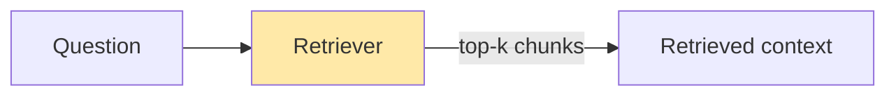

# Lecture 13 — Evaluating RAG Retrievers (Hands-On with DeepEval)

> **Source lecture:** [How to Test RAG Retrievers (Hands-On)](https://www.youtube.com/watch?v=9Dkz3ckRj8c) (CampusX)
> **What this note adds:** beginner explanations of chunking, embeddings and rerankers; **the exact DeepEval contextual-precision formula, which corrects the lecture's simplified calculation**; fully worked examples; and a code skeleton. Corrections are marked ✏️; extra material is marked 🔎.

---

## 1. Goal of this lecture
Build the **retriever** of the CampusX Doubt Solver, then **evaluate and improve it**. This is the first half of the **component level** of the RAG eval suite. (The generator follows in lecture 14.)


Only the highlighted part is under test today.

---

## 2. Project setup
```
rag-eval-project/
├── data/      session transcripts (.vtt subtitle files), the knowledge base
├── src/       retriever.py, reranker.py, later generator.py and rag_pipeline.py
├── evals/     eval_retriever.py, …
├── goldens/   golden datasets (JSON)
└── .env       OPENAI_API_KEY=...
```
- Environment: `uv init` with Python 3.11, then install `langchain`, `openai`, `deepeval`, `pytest`, `python-dotenv`.
- **uv** is a fast Python package/environment manager. **`.env`** holds secret keys outside the code.

---

## 3. Building the retriever (step by step)

### 3.1 Load the transcripts
`.vtt` files look like movie subtitles: a timestamp line, then the spoken text.
- **Drop the timestamp lines** and keep only the text. Timestamps scattered through the text would pollute its meaning and hurt retrieval.
- Save each file as a LangChain `Document` with **metadata** `session = N`, so the bot can later cite *which session* taught something.

### 3.2 Chunk
**Chunking** = splitting long text into smaller overlapping pieces.
- `chunk_size = 750` characters, `chunk_overlap = 100` (the starting values), which gives ~800+ chunks.
- **Overlap** = the last 100 characters of one chunk are repeated at the start of the next, so a sentence cut at a boundary isn't lost.

```
|---------- chunk 1 (750) ----------|
                          |--100--|---------- chunk 2 (750) ----------|
```

> 💡 **Trade-off:** small chunks are precise but may miss context. Big chunks carry more context but more noise.

### 3.3 Embed and store
- Embedding model: OpenAI **`text-embedding-3-small`**, which converts each chunk into a vector (a list of numbers capturing its meaning).
- Store the vectors in **Chroma**, a local vector database (folder `chroma_store/`, created only if it doesn't already exist).

### 3.4 Retrieve
`as_retriever(k=5)`: for a question, embed it and return the **5 nearest chunks** by meaning.

**Smoke test:** "What is regression testing?" returns 5 sensible chunks. It *works*, but we don't yet know *how well*.

**Q&A: what about new transcripts?** Add them to `data/`, delete `chroma_store/` and re-run (re-embed everything). In production you would **decouple ingestion** (adding documents) from retrieval. The lecture code is deliberately simple to keep the focus on evaluation.

---

## 4. How a retriever fails, and the two metrics

Say the correct chunks for a question are **{1, 13, 15}**.

| Failure mode | What the retriever returns | What goes wrong | Metric that catches it |
|---|---|---|---|
| **A. Misses the right context** | {27, 28, 29} | The generator never sees the answer | **Recall** |
| **B. Right context, but noisy** | {1, 15, 27, 28, 29} | The generator gets 2 useful + 3 distracting chunks | **Precision** |

- **Recall** = correct chunks retrieved ÷ all correct chunks. *Example:* 3 of 5 needed chunks found gives **3/5 = 0.6**.
- **Precision** = useful chunks retrieved ÷ chunks retrieved. *Example:* 2 of 5 retrieved chunks useful gives **2/5 = 0.4**.
- The ideal is **both close to 1**.

### The tug-of-war: k controls the trade-off
- Increase **k** (5 → 10): you're more likely to include everything needed, so **recall ↑**, but you also bring more junk, so **precision ↓**.
- At the extreme, retrieving *every* chunk gives recall = 1 and precision ≈ 0.

> 💡 **Analogy:** fishing with a bigger net catches every fish you want (recall), but also a lot of weeds (lower precision).

Both metrics are **reference-based**: you need to know in advance what "correct" looks like for each question, so you need a **golden dataset**.

---

## 5. The naive method: golden chunk IDs (and why it fails here)

### How it works
| Question | Correct chunk IDs |
|---|---|
| What is regression testing? | 72, 89, 100 |
| What is the RAG triad? | 111, 120 |
| What are online evals? | 121, 130, 151 |

For Q1 the retriever returns {72, 81, 89, 99, 100}:
- Recall = 3/3 = **1.0**
- Precision = 3/5 = **0.6**

For Q2 it returns {1, 2, 3, 120, 5}:
- Recall = 1/2 = **0.5**
- Precision = 1/5 = **0.2**

Average over all questions.

### Why it fails for this project
1. **Labelling is brutal.** For each of ~50 questions, a person must read ~800 chunks to find the relevant ones.
2. **Any chunking change makes the dataset useless.** Change the chunk size (750 → 1000) and you get **new chunks with new IDs**, so every label is now wrong and you must relabel from scratch. Tuning chunking is exactly what you want to do while improving a retriever.

**When the ID method *is* fine:** documents are cleanly separated (e.g. one FAQ entry per document) and chunking never changes. That's not our case: the same topic is taught across several sessions.

---

## 6. The better method: question + ideal answer, judged by an LLM

### New golden dataset
| Question | Ideal answer (written from what was *taught* in class, not from Google) |
|---|---|
| What is regression testing? | "Regression testing checks that a new version isn't worse than the previous one. It runs the whole eval suite against the software. It can be used in CI to gate deployments." |

✅ **Survives re-chunking:** the ideal answer doesn't change when the chunks move.

### 6.1 Contextual recall: "was everything needed retrieved?"
1. Retrieve the top-k chunks for the question.
2. A **judge LLM** splits the **ideal answer** into **atomic claims** (small standalone facts):
   - (a) it checks the new version isn't worse
   - (b) it runs the eval suite
   - (c) it is usable in CI
3. For each claim, the judge checks whether it is **supported by (attributable to) any retrieved chunk**.
4. **Contextual recall = supported claims ÷ total claims.**
   - Regression testing: all 3 found gives **3/3 = 1.0**.
   - RAG triad (2 claims, 1 found) gives **1/2 = 0.5**.
5. Average over all questions.

Official formula: Contextual Recall = attributable statements ÷ total statements in the expected output. [DeepEval docs](https://deepeval.com/docs/metrics-contextual-recall).

**Design tips that make this work:**
- Write ideal answers as **short, atomic statements** so they're easy to split.
- Use a **strong judge model** with a clear prompt.

> This is different from **Recall@k**, the ID-based version from lecture 5.

### 6.2 Contextual precision: "are the useful chunks ranked at the top?"
**Step 1: judge each chunk.** The judge sees *question + ideal answer + one retrieved chunk* and is asked: "Does this chunk contain information that helps produce the expected answer? Yes/no + reason." Each chunk is labelled **relevant (1)** or **noise (0)**.

**Step 2: rank-aware scoring.** Plain precision ignores order. These two retrievals have the same plain precision (2/5):

| Position | 1 | 2 | 3 | 4 | 5 |
|---|---|---|---|---|---|
| **Case A** | ✅ | ✅ | ❌ | ❌ | ❌ |
| **Case B** | ❌ | ❌ | ❌ | ✅ | ✅ |

Case A is clearly better: the generator sees the good chunks first. (Recall "lost in the middle" from lecture 4.)

✏️ **Correction: the exact DeepEval formula.** The lecture explained it as "compute precision at *every* position and average all 5 values". DeepEval's documented formula **only adds up precision at the positions where a relevant chunk appears**, and divides by the **number of relevant chunks**. [DeepEval: Contextual Precision](https://deepeval.com/docs/metrics-contextual-precision):

$$\text{Contextual Precision} = \frac{1}{\text{\# relevant chunks}} \sum_{k=1}^{n} \left(\frac{\text{relevant chunks in top }k}{k}\right) \times r_k$$

where **r_k = 1 if the chunk at position k is relevant, else 0**.

**Worked comparison**

| | Precision at each relevant position | DeepEval score | Lecture's simplified method (average over all 5 positions) |
|---|---|---|---|
| **Case A** ✅✅❌❌❌ | pos 1: 1/1, pos 2: 2/2 | (1 + 1) / 2 = **1.00** | (1 + 1 + 0.67 + 0.5 + 0.4) / 5 ≈ 0.71 |
| **Case B** ❌❌❌✅✅ | pos 4: 1/4, pos 5: 2/5 | (0.25 + 0.40) / 2 = **0.325** | (0 + 0 + 0 + 0.25 + 0.4) / 5 = 0.13 |

Both methods agree on the **key idea**: relevant chunks ranked higher get a higher score. But only the DeepEval formula gives a **perfect 1.0** when every relevant chunk is at the top, no matter how many irrelevant chunks come after. In other words, DeepEval's contextual precision measures **ordering**, while the *amount* of noise is captured more by contextual relevancy (lecture 14).

> Both metrics now use an **LLM judge**, so this is no longer a purely programmatic eval.

---

## 7. Building the golden dataset: four methods

| Method | How | Pros | Cons |
|---|---|---|---|
| **1. Hand-authored** | A domain expert (here, the teacher) writes questions, finds the chunks, writes ideal answers | Best quality | Slow, tiring, expensive |
| **2. LLM-assisted drafting** ✅ *(used)* | Give the transcripts to Claude with clear instructions; generate **one Q&A at a time**; a **human reviews every item** | Fast and cheap | The LLM may add facts that were never taught, so review and delete them |
| **3. DeepEval Synthesizer** | `Synthesizer` generates Q&A pairs from random chunks | Automated | The instructor got poor results: unnatural questions ("Assess methodologies to validate LLMs' robustness against adversarial exploits…"), off-focus ones (details of a UPSC example) |
| **4. Production logs** | After launch, add positively rated (thumbs-up) interactions | Real user language | Can't be your first source |

The final `goldens/retriever_goldens.json` has **15 questions in student-like language**, e.g.:
- "What is an online eval and how is it different from offline?"
- "What is faithfulness vs groundedness?"
- "How do I know if my eval is reference-based or reference-free?"
- "Why can't we test LLM apps the same way we test normal software?"

---

## 8. DeepEval in three building blocks

| Block | What it is | Analogy |
|---|---|---|
| **`LLMTestCase`** | **One row** of your golden dataset: `input`, `actual_output`, `expected_output`, `retrieval_context` | One exam question with the student's answer |
| **Metric** | What to measure, e.g. `ContextualRecallMetric(model=..., threshold=0.7, include_reason=True)` | The marking scheme |
| **`evaluate()`** | Runs the metrics over the test cases | The examiner |

- **threshold**: the minimum score for a test case to count as *passed*.
- **include_reason**: the judge explains *why* it gave a score (great for debugging).

### Code skeleton (`evals/eval_retriever.py`)
```python
import json
from deepeval import evaluate
from deepeval.test_case import LLMTestCase
from deepeval.metrics import ContextualRecallMetric, ContextualPrecisionMetric
from src.retriever import build_retriever

goldens = json.load(open("goldens/retriever_goldens.json"))
retriever = build_retriever()

test_cases = []
for g in goldens:
    chunks = retriever.invoke(g["question"])
    test_cases.append(LLMTestCase(
        input=g["question"],
        actual_output="Generator not evaluated in this run",   # placeholder
        expected_output=g["ideal_answer"],
        retrieval_context=[c.page_content for c in chunks],
    ))

metrics = [
    ContextualRecallMetric(model="gpt-4o-mini", threshold=0.7, include_reason=True),
    ContextualPrecisionMetric(model="gpt-4o-mini", threshold=0.7, include_reason=True),
]
evaluate(test_cases=test_cases, metrics=metrics)
```
- Also **log the configuration** (embedding model, chunk size, overlap, k, judge model, dataset file) so every result can be reproduced.
- Run it as a module: `python -m evals.eval_retriever`. Add an empty `__init__.py` to `src/` and `evals/` to fix `ModuleNotFoundError: src`.

---

## 9. Improving the retriever (the results)

| Run | Change | Contextual recall | Contextual precision | Failing (of 15) |
|---|---|---|---|---|
| Baseline | chunk 750 / overlap 100, `text-embedding-3-small`, k = 5 | 0.80 | 0.80 | 5 |
| 2 | **chunk 1000 / overlap 150** (697 chunks; rebuild Chroma) | **0.97** | 0.83 | 3 |
| 3 | + **reranker** | 0.92 | **0.85** | 2 |
| 4 | + **`text-embedding-3-large`** (rebuild) | **0.99** | 0.85 | 3 |
| 5 | k = 3 | ~ | 0.84 | no real gain |

**Why each change helps:**
- **Bigger chunks** carry more complete explanations, so recall ↑.
- **Reranker** (🔎 how it works): the first retrieval uses a fast *bi-encoder* (the question and chunks are embedded separately and compared). A reranker is usually a *cross-encoder*, which reads the question and a chunk **together** and scores their match more accurately, then re-sorts the chunks. Because contextual precision rewards good ordering, rerankers raise it. (A better reranker than the basic one used here would help more.)
- **Larger embedding model** captures meaning more accurately, so recall ↑ (at higher cost).

**Run-to-run variance:** with only **15 rows**, one test case = 6.7% of the score, so numbers wobble. Use bigger golden sets for stable results.

**Outcome:** recall > 0.95 and precision ≈ 0.85. You can now build the generator with *measured* confidence in retrieval quality. Further ideas: a stronger reranker, more chunking experiments (e.g. 1500/200).

---

## 10. Quick revision
- Retriever failures: **miss** (recall) or **noise** (precision); k trades one against the other.
- Chunk-ID golden sets break whenever chunking changes, so use **question + ideal answer** with an LLM judge.
- **Contextual recall** = ideal-answer claims found in the retrieved chunks ÷ total claims.
- **Contextual precision** (DeepEval) = rank-weighted precision averaged over the **relevant** positions only.
- DeepEval = `LLMTestCase` + metrics + `evaluate()`.

### Self-test
1. Why does changing `chunk_size` break a chunk-ID golden dataset but not an ideal-answer one?
2. Compute DeepEval contextual precision for ✅❌✅❌❌.
3. Why might adding a reranker raise precision but slightly lower recall?

<details><summary>Answers</summary>

1. New chunk sizes produce new chunks with new IDs, so the labels point at chunks that no longer exist. The ideal answer stays the same.
2. Relevant at positions 1 and 3: (1/1 + 2/3) / 2 = (1 + 0.667) / 2 ≈ **0.83**.
3. A reranker that also trims or reorders the list can push a needed chunk out of the top-k passed on, so slightly less needed information arrives even though ordering improves. Small datasets also add noise.
</details>
