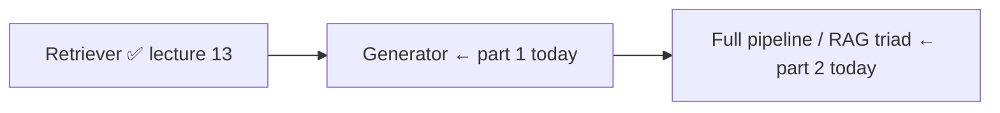
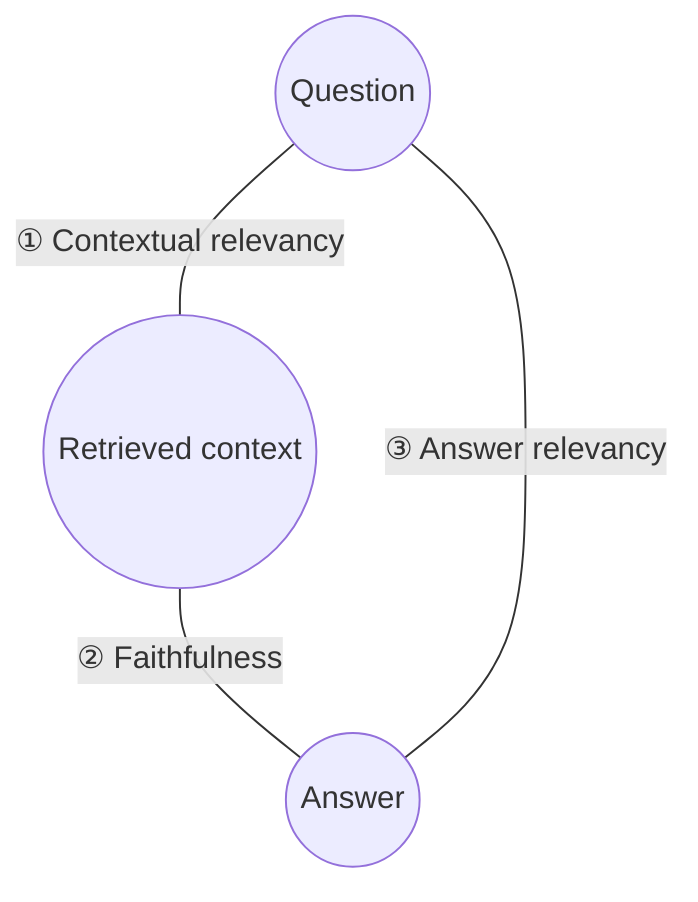

# Lecture 14 — Evaluating the Generator & the Full Pipeline (RAG Triad)

> **Source lecture:** [Evaluating RAG: Testing the Generator & Full Pipeline with the RAG Triad](https://www.youtube.com/watch?v=PATGn2XhmCY) (CampusX)
> **What this note adds:** plain-language metric explanations with worked numbers, official DeepEval formulas, the "faithful ≠ correct" matrix, how these metrics differ from the retriever metrics, and an explanation of the lecture's "good retriever, low context relevance" puzzle. 🔎 marks material beyond the lecture; ✏️ marks clarifications.

---

## 1. Where we are



---

## PART 1: The generator

## 2. Building the generator (`src/generator.py`)
- **LLM:** GPT-4o mini (cheap), `temperature = 0`. Temperature controls randomness; 0 means the most predictable output.
- **Prompt:**
  > "You are a helpful teaching assistant for a course on LLM evaluations. Answer the student's question **only from the context** below.
  > Rules: use only information in the context, no outside knowledge. If the context isn't enough, say: *'I don't have enough information in the course material to answer that.'* Keep the answer clear and concise."
- **LangChain chain:** `prompt | llm | StrOutputParser()`: fill the template, call the LLM, extract the plain text. Wrapped in a function `generate(query, context)`.
- **Smoke test** with a made-up context: "What is online eval?" gets a correct answer. It *works*; quality is still unmeasured.

## 3. How a generator fails

| Failure | Example | Metric |
|---|---|---|
| **Unfaithful (hallucinated)**: adds facts not in the context | Q: "Does the AI Engineering program include live classes?" Context: recorded lessons, assignments, projects, weekly doubt sessions (no mention of live classes). Answer: "**Yes, two live classes every week**…" ❌ | **Faithfulness** |
| **Faithful but irrelevant**: sticks to the context but doesn't answer | Answer: "The program includes coding assignments, projects, recorded lessons and weekly doubt sessions." True, but it dodges *"live classes?"* | **Answer relevancy** |

A good answer is both faithful **and** relevant: *"The provided context doesn't confirm live classes. It only mentions recorded lessons, assignments, projects and weekly doubt sessions."*

> ⚠️ **Faithful ≠ correct.** Faithfulness only promises *"nothing beyond the context"*. If the retriever brought wrong context, a faithful answer will be faithfully wrong.

| | Answer matches the context | Answer adds outside info |
|---|---|---|
| **Context is correct** | ✅ Faithful and correct | Unfaithful (may still be correct) |
| **Context is wrong** | Faithful but wrong | Unfaithful, may be wrong |

The Air Canada chatbot case (lecture 1) was a **generator failure**: it invented a refund policy.

Other generator metrics (**citation accuracy, completeness, correctness**) are deferred to the application level (lecture 15).

---

## 4. How the generator metrics are computed

### 4.1 Faithfulness (reference-based at the component level)
**Golden dataset:** *question → **golden context*** (all chunks that genuinely discuss the topic, picked by a human or reviewed LLM).

**Steps:**
1. Send the question + golden context to the generator. **The retriever is not involved (isolation).**
2. A judge LLM splits the **generated answer** into **claims**.
3. For each claim, ask: **is it supported by the context?**
4. **Faithfulness = supported claims ÷ total claims.**

**Worked example.** Q: *"What does it mean for a benchmark to get saturated?"*

| Claim in the answer | In the context? |
|---|---|
| "Model scores cluster near the top" | ✅ |
| "The benchmark can no longer tell models apart" | ✅ |
| "Saturation happens after exactly two years" | ❌ |
| **Faithfulness** | **2/3 ≈ 0.67** |

Official formula: Faithfulness = truthful claims ÷ total claims. [DeepEval: Faithfulness](https://deepeval.com/docs/metrics-faithfulness).

✏️ 🔎 *Implementation nuance:* in DeepEval, the judge decides whether each claim *agrees with* the retrieval context. A claim the context **contradicts** clearly counts against you. Claims the context neither supports nor contradicts may be treated more leniently depending on configuration (DeepEval exposes an option to penalise such ambiguous claims). Check the docs for your version before interpreting borderline scores.

**Faithfulness vs contextual recall** (they look similar but point in opposite directions):

| | Contextual recall (lecture 13) | Faithfulness |
|---|---|---|
| Claims taken from | The **ideal answer** | The **generated answer** |
| Checked against | The **retrieved** context | The **given** context |
| Question | "Did retrieval bring everything needed?" | "Did generation stay within what was given?" |

### 4.2 Answer relevancy (reference-free)
**Steps:**
1. Split the **answer** into statements.
2. For each statement, ask: **does it help answer the question?**
3. **Answer relevancy = relevant statements ÷ total statements.**

**Worked example:** *"A benchmark gets saturated when scores cluster high, so it can't tell models apart. **Separately, benchmark contamination is when test data leaks into training data.**"*
- 2 relevant statements + 1 off-topic gives **2/3 ≈ 0.67**.

No reference answer is needed: the dataset only supplies questions to generate answers from. Official formula: relevant statements ÷ total statements. [DeepEval: Answer Relevancy](https://deepeval.com/docs/metrics-answer-relevancy). DeepEval's own docs note that answer relevancy **doesn't check grounding**, which is why it's paired with faithfulness.

### 4.3 Q&A from the lecture
| Question | Answer |
|---|---|
| Same LLM for splitting claims and judging them? | Yes. Each API call is independent, so a second model adds nothing. |
| Can the judge make mistakes? | Yes. But a judge's bias is **consistent across runs**, so comparisons stay fair ("a bad pitch is bad for both teams"). Use the **strongest judge you can afford**; eval sample sizes are small. |
| Is the number of claims a setting? | No; the judge decides. |
| Does relevant mean correct? | **No.** Correctness is a separate metric (lecture 15). |
| Non-RAG apps? | DeepEval has multi-turn chat metrics and **custom metrics** (G-Eval, lecture 15). |

---

## 5. The generator's golden dataset
- `export_chroma_chunks.py` exports all **862 chunks** to JSON. Claude then generates **one question + golden context at a time**, and the instructor (who taught the classes) **reviews** each one.
- Result: **15 rows** in `goldens/faithfulness_dataset.json`.

## 6. The generator eval (`evals/eval_generator.py`)
```python
for g in goldens:
    answer = generate(g["question"], g["golden_context"])
    cases.append(LLMTestCase(
        input=g["question"],
        actual_output=answer,
        retrieval_context=g["golden_context"],   # NOT from the retriever
    ))
evaluate(cases, [FaithfulnessMetric(...), AnswerRelevancyMetric(...)])
```
DeepEval runs test cases **in parallel**, so it's quick.

### Results and improvement
| Run | Faithfulness | Answer relevancy |
|---|---|---|
| Baseline prompt | **0.91** | **0.73** |
| Refined prompt (3–4 iterations) | **0.96** | **0.92** (14/15 pass) |

**Why is faithfulness high from the start?** Modern LLMs are good at following "answer only from the context". **Answer relevancy is harder**: the model must *understand* what's being asked.

**Levers for improving a generator** (fewer than for a retriever):
1. **A better model** (better instruction following).
2. **A better system prompt.** Collect the failing cases and the judge's reasons, give them to an LLM (Claude), and ask for prompt fixes. Rules added in the final prompt:
   - "Do not strengthen or overstate claims."
   - "If the context says two things are different, don't upgrade that to 'separate methods' or other strong wording."
   - "The context is an informal lecture transcript: synthesise and rephrase what's there; don't require the question's exact wording to appear."

⚠️ **Overfitting risk:** tuning a prompt too tightly to 15 examples can make it fail on *real* retrieved context. The pipeline eval below checks this.

### Experiment tracking with Confident AI
`deepeval view` (log in + API key) uploads the run to **Confident AI** (DeepEval's parent company): pass/fail per row, reasons, and the run configuration. This is MLflow-style **experiment tracking**: each prompt change becomes a recorded experiment you can compare.

✅ **Component level complete:** contextual recall and precision (retriever), faithfulness and answer relevancy (generator).

---

## PART 2: The full pipeline

## 7. Building the pipeline (`src/rag_pipeline.py`)
```python
class RAGPipeline:
    def invoke(self, question):
        chunks = reranking_retriever.invoke(question)        # retriever + reranker
        context = "\n\n".join(c.page_content for c in chunks)
        return generate(question, context), chunks
```
Test: "What is drift and why does it matter after deployment?" gives a sensible answer from 5 retrieved chunks.

## 8. The RAG triad



| # | Pair | Metric | Reference needed? |
|---|---|---|---|
| ① | Question ↔ context | **Contextual relevancy** | No |
| ② | Context ↔ answer | **Faithfulness** | No (it compares answer vs context) |
| ③ | Question ↔ answer | **Answer relevancy** | No |

**What's different from the component level?** The **context now comes from the real retriever**, not the golden dataset. The formulas are the same, but the scores differ, because now retrieval quality affects generation.

### Contextual relevancy, step by step
1. Send the question to the **retriever**, which returns k = 5 chunks.
2. The judge **splits every chunk into statements** (e.g. 15 statements in total).
3. For each statement: **is it relevant to the question?** (yes/no)
4. **Contextual relevancy = relevant statements ÷ total statements** (e.g. 10/15 ≈ 0.67).

Official formula: [DeepEval: Contextual Relevancy](https://deepeval.com/docs/metrics-contextual-relevancy).

## 9. The pipeline eval (`evals/eval_rag_pipeline.py`)
Uses only the **questions** from `faithfulness_dataset.json`; `actual_output` and `retrieval_context` come **from the pipeline**. Metrics: Faithfulness, AnswerRelevancy, ContextualRelevancy.

| RAG triad metric | Score |
|---|---|
| Faithfulness | **≈ 0.92–0.93** |
| Answer relevancy | **≈ 0.86**: the refined prompt **generalises** (it wasn't overfit) |
| **Contextual relevancy** | **≈ 0.42–0.43** ⚠️ |

---

## 10. The puzzle: a "good" retriever with low contextual relevancy
Re-running the retriever eval gives **recall 0.99, precision 0.89**. So why is contextual relevancy only **0.42**?

| Metric | Unit it judges | Question |
|---|---|---|
| Recall | The **ideal answer's** claims | Was all needed info retrieved? ✅ |
| Precision | Whole **chunks** | Is each chunk useful, and are useful chunks ranked high? ✅ |
| **Contextual relevancy** | **Statements inside each chunk** | How much of the retrieved *text* is on-topic? ❌ |

**The answer: noise *inside* chunks.** A 1,000-character chunk may contain 1–2 relevant sentences and 4–5 sentences about something else. **Precision counts the chunk as useful** (it helps); **contextual relevancy counts most of its sentences as irrelevant**.

```
Chunk 3 (counted "useful" by precision)
┌──────────────────────────────────────────┐
│ ✅ Drift means performance changes over…   │
│ ❌ Okay guys, let's take a quick break…    │
│ ❌ Someone asked about the fee earlier…    │
│ ❌ The UPSC example from last week…        │
│ ✅ It matters because the golden set…      │
└──────────────────────────────────────────┘
relevant statements = 2/5 = 0.4
```

Spoken-lecture transcripts are especially chatty, which makes this worse.

**Fixes:**
- **Smaller chunks** / less overlap.
- 🔎 **Contextual compression**: extract only the relevant sentences from each chunk before sending them to the LLM.
- Better segmentation, e.g. by topic.
- ⚠️ **Trade-off:** smaller chunks can lower recall and faithfulness, so re-check all metrics (this is what regression testing in lecture 18 is for).

**Pragmatic view:** if faithfulness, answer relevancy, recall and precision are all good, a lowish contextual relevancy can be **acceptable**, because the final answers are good. It mainly costs extra tokens (money and latency) and risks distraction.

> This puzzle reappears in lecture 18, where shrinking the chunks to fix it caused regressions.

---

## 11. Status
- ✅ Component level (4 metrics)
- ✅ Pipeline level (RAG triad)
- ⏭️ Application level: quality (correctness, completeness, style via **G-Eval**), safety, ops

In DeepEval's RAG section there are **five** core metrics, and we've now used all of them: answer relevancy, faithfulness, contextual precision, contextual recall, contextual relevancy.

### Self-test
1. The context says "the course has 12 sessions" and the answer says "the course has 12 sessions and a certificate". What's the faithfulness score (2 claims)?
2. Why is answer relevancy reference-free while faithfulness at the component level used a golden context?
3. Precision is 0.9 and contextual relevancy is 0.4. What does that tell you?

<details><summary>Answers</summary>

1. 1/2 = 0.5. The certificate claim isn't in the context.
2. Answer relevancy only needs the question and answer. The component-level faithfulness test fed a *known-good* context to isolate the generator; faithfulness itself compares the answer with whatever context was given.
3. Most chunks are useful, but they're padded with lots of irrelevant text. Consider smaller chunks or compression.
</details>
