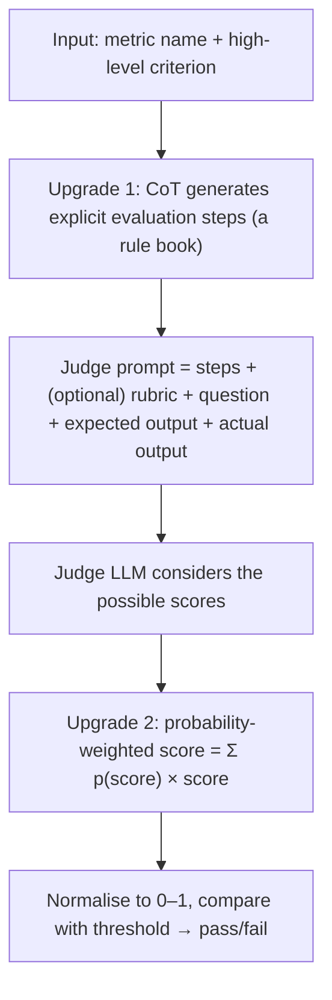
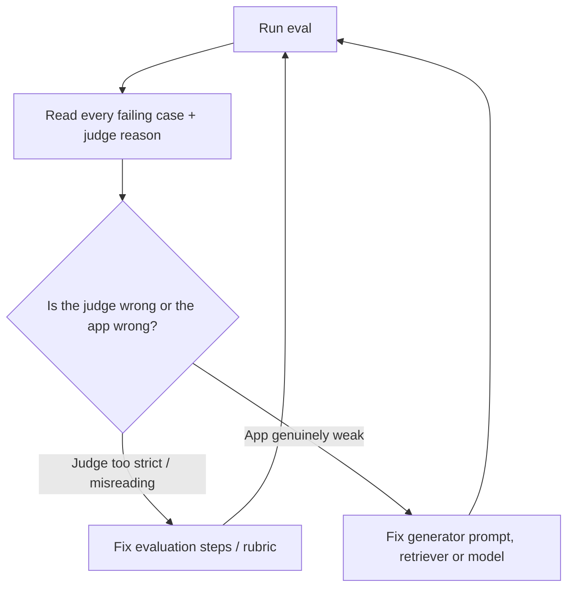

# Lecture 15 — G-Eval: Reliable Judgment-Based Metrics (Correctness, Completeness, Style)

> **Source lecture:** [Mastering G-Eval: The Deterministic LLM-as-a-Judge Framework Explained](https://www.youtube.com/watch?v=nlyxlKD5cvU) (CampusX)
> **What this note adds:** a slow, intuitive walkthrough of *why* naive judges are noisy, the G-Eval maths with a worked example, **what the original paper actually did**, and **corrections about DeepEval's `strict_mode` and the "deterministic" claim**. ✏️ marks corrections, 🔎 marks extra material.

---

## 1. Two families of metrics

| | **Count-based** | **Judgment-based** |
|---|---|---|
| How | Split into claims, label each, compute a ratio | Read the **whole answer** and give a score |
| Examples | Recall, precision, faithfulness, answer relevancy, contextual relevancy (lectures 13–14) | **Correctness, completeness, style**, helpfulness, safety |
| Why it's needed | — | Some qualities only exist at the **whole-answer** level |

**Why counting fails for these:**
- **Style:** a "CampusX style" answer flows *why → what → how*. That structure lives across the whole answer, not in any single sentence.
- **Correctness:** an **analogy** checked on its own ("it's like a cricket umpire…") looks unrelated to the golden answer and would be wrongly marked false. Correctness must be judged **in context**.
- Others: completeness, helpfulness, safety.

---

## 2. Naive LLM-as-a-judge for correctness
- **Golden dataset:** question + **correct answer** (universally correct, not necessarily what the teacher said).
- **Judge prompt:** "Compare the actual answer against the expected answer and decide how factually correct it is. Give a score from 0 to 10."
- Average over the 15 questions.

### The problem: scores jump around between runs
Run the same evaluation twice with nothing changed and you might get 60%, then 70%, then 75%. There are two reasons.

**Reason 1: a loose criterion.** "Decide how factually correct it is" is vague. On each independent call the judge may interpret "correct" differently: strict about details one time, lenient the next. There's no **rule book**.

**Reason 2: only the single most likely number is used.** LLMs produce text one token at a time by assigning **probabilities** to every possible next token, then outputting the most likely one.

```
Run 1:  P("7") = 0.40   P("8") = 0.51   P("6") = 0.09   → prints "8"
Run 2:  P("7") = 0.51   P("8") = 0.40   P("6") = 0.09   → prints "7"
```
The judge was *torn between 7 and 8* both times, but you only see a hard **8 or 7**. That flip-flop is the noise.

> 💡 **Analogy:** asking a hesitant examiner for one whole number. They say "8" today and "7" tomorrow, even though they really think "somewhere around 7.5".

(The judge making genuine mistakes, cost and latency are also real issues, but with only ~15 samples they aren't the main problem.)

---

## 3. G-Eval: the fix

**Paper:** *"G-Eval: NLG Evaluation using GPT-4 with Better Human Alignment"*, Liu et al., 2023. [arXiv:2303.16634](https://arxiv.org/abs/2303.16634)

G-Eval = **LLM-as-a-judge + two upgrades**:



### Upgrade 1: turn a vague criterion into explicit evaluation steps
Using **chain-of-thought (CoT)**, i.e. asking the model to think step by step, G-Eval converts:
> *"Decide how factually correct the actual answer is compared with the expected answer."*

into a numbered rule book such as:
1. Compare only the factual claims in the actual output against the expected output.
2. A claim is wrong only if it contradicts the expected output or is factually false.
3. A factually accurate answer scores high even if it is shorter or covers fewer points.
4. Do not deduct for brevity or omitted points; only wrong statements count.
5. Additional correct information must never lower the score.

Every judge call now uses the **same detailed steps**, leaving less room to improvise. You can add a **scoring rubric** too (e.g. 9–10 = fully correct, 5–8 = minor inaccuracies, 0–4 = a clear error).

### Upgrade 2: a probability-weighted score
Instead of taking the single printed number, look at the **probabilities of the score tokens** and compute their **weighted average**.

**Worked example.** Suppose the judge's top candidate tokens are:

| Token | Probability |
|---|---|
| "8" | 0.70 |
| "7" | 0.20 |
| "9" | 0.05 |
| "the" | 0.01 ← not a number, ignore |
| ":" | … ← ignore |

1. Keep only the numeric tokens: 0.70 + 0.20 + 0.05 = 0.95.
2. **Renormalise** so they sum to 1: 0.70/0.95 = **0.737**, 0.20/0.95 = **0.211**, 0.05/0.95 = **0.053**.
3. **Weighted score** = 8 × 0.737 + 7 × 0.211 + 9 × 0.053 ≈ **7.84** (the plain approach would say **8**).
4. Divide by 10 to get **0.784**, then compare with the threshold (e.g. 0.7) → **pass**.

Small shifts in the judge's confidence now move the score slightly (7.8 → 7.6) instead of flipping it (8 → 7). The scores are more **continuous** and **stable**.

The paper states the formula as **score = Σᵢ p(sᵢ) × sᵢ**. It motivates this with two problems of direct scoring: one score value tends to dominate, and LLMs mostly output integers, which causes many ties.

🔎 **What the paper actually did:**
- GPT-4's API **didn't expose token probabilities** at the time, so the authors **estimated them by sampling 20 answers** (n = 20, temperature = 1, top_p = 1) and counting how often each score appeared.
- They tested on **SummEval** (summarisation), **Topical-Chat** (dialogue) and **QAGS** (hallucination in summaries).
- They **warned that LLM judges may prefer LLM-generated text** over human-written text (self-preference bias).

> **In one line:** G-Eval is LLM-as-a-judge with (1) criteria turned into explicit evaluation steps (plus a rubric) and (2) a probability-weighted score. Nothing more mysterious than that.

✏️ **Correction: "deterministic".** The lecture title calls G-Eval "deterministic". It is **much more stable**, but **not perfectly deterministic**: DeepEval's own docs say G-Eval "is NOT deterministic". Expect small run-to-run variation (the lecture saw 0.84 → 0.83).

---

## 4. G-Eval in DeepEval

```python
from deepeval.metrics import GEval
from deepeval.test_case import LLMTestCaseParams
from deepeval.metrics.g_eval import Rubric

correctness = GEval(
    name="Correctness",
    evaluation_steps=[                       # OR criteria="..." (not both)
        "Compare only the factual claims in the actual output against the expected output.",
        "A claim is wrong only if it contradicts the expected output or is factually false.",
        "A factually accurate answer must score at least 9 even if it's shorter or covers fewer points.",
        "Do not deduct for brevity or omitted points.",
    ],
    rubric=[
        Rubric(score_range=(0, 4),  expected_outcome="Contains a clear factual error."),
        Rubric(score_range=(5, 8),  expected_outcome="Mostly correct, one or two small inaccuracies."),
        Rubric(score_range=(9, 10), expected_outcome="All claims factually correct."),
    ],
    evaluation_params=[LLMTestCaseParams.INPUT,
                       LLMTestCaseParams.ACTUAL_OUTPUT,
                       LLMTestCaseParams.EXPECTED_OUTPUT],
    model="gpt-4o-mini",
    threshold=0.7,
)
```

🔎 **Facts from the [DeepEval G-Eval docs](https://deepeval.com/docs/metrics-llm-evals):**

| Parameter / behaviour | What it does |
|---|---|
| `criteria` **or** `evaluation_steps` | You can give **one or the other, not both**. With `criteria`, DeepEval generates the steps for you (the CoT step). With `evaluation_steps`, that generation is **skipped**. |
| Score computation | Uses the **probabilities of the output tokens** to take a weighted sum (when the model provides log-probabilities). With a custom model that doesn't, it falls back to the raw integer score. |
| `rubric` | A list of non-overlapping score bands within **0–10**. A DeepEval addition, not part of the original paper. |
| Final score | Normalised to **0–1**; compared with `threshold` (default 0.5). |
| `strict_mode` | ✏️ **Forces a binary score: 1 for a perfect result, otherwise 0** (and sets the threshold to 1). Default `False`. |

✏️ **Correction about `strict_mode`:** the lecture said `strict_mode=False` is what *enables* the weighted log-probability calculation, and `True` uses the raw score. According to the docs, `strict_mode` is about **pass/fail binarisation** (perfect = 1, else 0). The probability weighting is DeepEval's normal behaviour when log-probabilities are available. **Keep `strict_mode=False` for graded scores**: the lecture's advice is right, but the reason is different.

### Criteria or your own steps?
| Phase | Use | Why |
|---|---|---|
| Early exploration | `criteria` | Let the LLM draft the steps while you learn how failures look |
| After 2–3 runs | Your own `evaluation_steps` + `rubric` | The same steps every call means less variance, and you encode what you learned |

The docs give the same recommendation: start with criteria, then lock in steps.

---

## 5. Correctness vs faithfulness (don't mix them up)

| | Faithful to the course context | Not faithful |
|---|---|---|
| **Correct (true in the world)** | ✅ Ideal | Answered from the model's general knowledge, ignoring the context |
| **Incorrect** | The teacher taught it wrong and the bot repeated it faithfully | Hallucinated **and** wrong |

The ideal answer is **correct and faithful**.

---

## 6. Hands-on: `evals/eval_application.py`
**Golden dataset:** `goldens/correctness_goldens.json`, 15 rows: question, ideal (correct) answer, source session.

For each row: question → `RAGPipeline` → `LLMTestCase(input, actual_output, expected_output)`.

### 6.1 Correctness

| Run | Change | Score | Pass / fail |
|---|---|---|---|
| 1 | Steps: compare key facts, heavily penalise contradictions, reward matching meaning, "don't penalise omissions" | **0.66** | 8 / 7 |
| 2 | **Stricter steps:** "a factually accurate answer must score **at least 9** even if shorter / less detailed / fewer examples / omitted points" + explicit **rubric** (0–4 / 5–8 / 9–10) | **0.84** | 14 / 1 |
| 3 | Re-run, no change | **0.83** | 14 / 1, **the same case (#7)** fails, which shows stability |

**Diagnosis from the judge's reasons:** the golden answers were very thorough, so the judge marked correct-but-shorter answers as incorrect. It was confusing **correctness** with **completeness**. Fix: make the judge's rules explicitly lenient on coverage.

### 6.2 Completeness
- **Idea:** if the ideal answer has points A, B and C, and the generated answer covers A and B, then completeness ≈ 7/10.
- Add a second G-Eval metric (`Completeness`, with its own steps and rubric) and pass both metrics to `evaluate`.

| Run | Change | Score | Pass / fail |
|---|---|---|---|
| 1 | — | **0.68** | 5 / 10 |
| 2 | **Generator prompt fix:** "Answer thoroughly. Identify every distinct part of the question and cover each one. Include all relevant points the context provides. If the question or concept has multiple parts, address all of them rather than stopping at the first." (Still context-only.) | **0.75** | 14 / 1 |

**Root cause:** the generator had been told to be **concise**, which cut coverage.

### 6.3 Style (CampusX teaching voice): reference-free
No ideal answer is needed, just a clear **style rubric**:
- **Reward** intuitive explanation in plain language; the idea before any formula or jargon; technical terms unpacked.
- **Reward** a conversational, direct register (like a CampusX lecture), not a dry textbook tone.
- **Reward** a concrete example, analogy or "why it matters" framing where it helps.
- **Bands:** 9–10 = clearly the CampusX voice. 5–8 = clear but flat or textbook-like. 0–4 = dry, stiff, jargon-heavy, robotic.

| Run | Change | Score | Pass / fail |
|---|---|---|---|
| 1 | The generator was never told about the style | **0.54** | — |
| 2 | **Generator prompt:** "Write in flowing conversational prose, like a teacher explaining out loud, not a bulleted list (lists only when the question needs enumeration). Explain the intuition first in plain language; unpack technical terms." **+ rubric fix:** "An analogy or example is a **bonus** when the concept is abstract; a clear, direct, well-explained answer is fully acceptable." | **0.74** | 9 / 6 |

**Lesson:** the judge had **over-weighted** "use analogies" and penalised every answer without one. Sometimes you fix the **judge**, not the app.

- Pushing style much higher may **hurt faithfulness** and other metrics.
- A threshold of **0.6** may be fairer than 0.7 here.

---

## 7. The debugging loop (how to use G-Eval in practice)



**Lessons**
1. **Read the failure reasons.** They tell you whether to fix the judge or the app.
2. **Prompt engineering really moves scores.** The right system prompt changed completeness and style substantially.
3. **Evaluation steps + rubric + weighted scoring** make judgment metrics **stable and repeatable** (though not perfectly deterministic).
4. 🔎 **Calibrate against humans:** label 20–30 answers yourself and check the G-Eval scores agree (as with the UPSC MAE check in lecture 5).
5. G-Eval also covers **coherence, tonality, helpfulness** and many **safety** metrics (lecture 16).

---

## 8. Quick revision
- **Count-based** metrics use claims and ratios. **Judgment-based** metrics need a whole-answer score.
- Naive judges are noisy because of **vague criteria** and **argmax score tokens**.
- G-Eval adds **explicit evaluation steps (+ rubric)** and a **probability-weighted score**: Σ p(s)·s.
- The paper estimated GPT-4's probabilities by sampling 20 times. DeepEval uses token log-probabilities.
- In DeepEval, `strict_mode` = binary pass/fail. `criteria` and `evaluation_steps` are mutually exclusive.

### Self-test
1. Score probabilities are 6: 0.5, 7: 0.3, 8: 0.2. What's the weighted score?
2. Why might giving your own `evaluation_steps` be more stable than giving `criteria`?
3. The correctness metric fails short-but-correct answers. Do you fix the judge or the app?

<details><summary>Answers</summary>

1. 6 × 0.5 + 7 × 0.3 + 8 × 0.2 = 3 + 2.1 + 1.6 = **6.7** (0.67 after normalising).
2. The steps are identical on every call. With `criteria`, the steps are generated by an LLM and may vary.
3. The **judge**. That's completeness behaviour leaking into correctness. Tell it not to penalise brevity or omissions.
</details>
