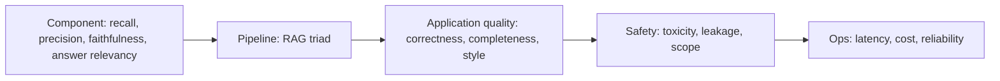

# Lecture 17 — Operational Evals: Latency, Cost & Reliability

> **Source lecture:** [RAG Operational Evals: Building Faster & Cheaper RAG Systems](https://www.youtube.com/watch?v=kuTgQM9zhq0) (CampusX)
> **What this note adds:** a worked percentile example, a latency-breakdown diagram, the maths of cost per query, checked facts about provider prompt caching, and clarifications of numbers in the lecture. ✏️ marks corrections, 🔎 marks extra material.

---

## 1. What operational evals answer
Quality evals ask *"Are the answers good?"* Operational ("ops") evals ask:
> **"Even if the answers are good, can the system run reliably, quickly and economically in production?"**

| | Quality / safety evals | **Ops evals** |
|---|---|---|
| Needs a golden dataset? | Often | **No** |
| Needs an LLM judge? | Usually | **No** |
| What it is | Judging outputs | **Measuring software behaviour** (timers, token counters, error counters) |
| Cost to run | Judge LLM calls | Only the app's own calls |

This lecture covers **latency**, **cost** and **reliability**. **Throughput** needs load testing and is out of scope.

---

## 2. Why ops evals belong offline too
Scenario: v2 adds a reranker, top-10 chunks and a bigger LLM.

| Metric | v1 | v2 |
|---|---|---|
| Correctness | 91% | **95%** ⬆️ |
| Faithfulness | 94% | **96%** ⬆️ |
| Answer relevance | 93% | **95%** ⬆️ |
| Avg latency | 2.3 s | **4.1 s** ⬇️ |
| P95 latency | 4.8 s | **6.2 s** ⬇️ |
| Avg cost/query | ₹0.72 | **₹1.08** ⬇️ |
| Timeout rate | 2% | 1% |
| Success rate | 99.8% | 99.9% |

Quality went up, but it became **~80% slower and 50% more expensive**. Without ops evals you'd only discover this from angry users or a shocking bill.

> **"Do not wait until production to discover that your RAG pipeline is too slow or too expensive."**

**Laptop numbers ≠ production numbers.** But the **direction of change** (v2 is slower than v1) is real, as long as both versions are measured on the same setup. Offline, trust the **difference**, not the absolute value. In production, observability tools (LangSmith, Confident AI) log these metrics automatically.

---

## 3. Latency

### 3.1 Definition
> **Latency** = the time from the user pressing Enter to receiving the full answer.

The naive measurement:
```python
start = time.perf_counter()
answer = rag_pipeline(question)
latency = time.perf_counter() - start
```
A *good* latency eval also follows the ten rules below.

### 3.2 The ten rules of latency measurement

**Rule 1: report distributions, not just averages.** Report **P50, P95 and P99**.

> **Percentile:** P95 = the time within which **95%** of requests finish. Only the slowest 5% take longer. **P50 = the median.**

🔎 **Worked example.** 10 requests (seconds), sorted:
`1.2, 1.4, 1.5, 1.6, 1.7, 1.8, 1.9, 2.1, 2.4, 9.8`

| Statistic | Value | What it tells you |
|---|---|---|
| Mean | (sum = 25.4) / 10 = **2.54 s** | Pulled up by the single 9.8 s outlier |
| P50 (median) | ≈ **1.75 s** | The typical user |
| P95 / P99 | ≈ **9.8 s** | The **unluckiest** users ("tail latency") |

The mean says "2.5 s, fine", but one user in ten waited almost 10 seconds. **Tail latency** is where user frustration lives. Dashboards show these over time windows (last 1 h, 24 h, week).

**Rule 2: break end-to-end latency into components.**

```
End-to-end 4.5 s
├── embed query      0.1 s
├── vector search    0.4 s
├── rerank           1.0 s
└── generate         3.0 s   ← the biggest slice: optimise here first
```

**Rule 3: measure TTFT (time to first token) separately.** Apps **stream** answers word by word, which helps in two ways:
1. It's easier to read along.
2. The user sees progress instead of a blank screen.

TTFT is often what users *feel* as speed.

**Rule 4: skip cold starts.** The first request is slow because things are starting up:
- loading models (e.g. downloading a reranker from Hugging Face)
- opening vector-DB connections
- network handshakes
- warming caches
- starting serverless containers

Discard warm-up runs.

**Rule 5: record output token count and context size.** Longer answers and bigger contexts take longer.

**Rule 6: distinguish latency from throughput.**

| | Latency | Throughput |
|---|---|---|
| Question | How long does **one** request take? | How many requests can we serve **per second**? |
| Restaurant analogy | How long one diner waits for food | How many diners the kitchen serves per hour |

When demand exceeds throughput (20,000 users vs capacity for 10,000), requests **queue up** and latency rises. Always state *at what concurrency* a latency number was measured.

**Rule 7: repeat runs.** External APIs are noisy. E.g. send each question 5 times and average.

**Rule 8: track failures alongside latency.**

| Run | P95 | Timeouts |
|---|---|---|
| A | 3 s | 2% |
| B | **2 s** | **8%** |

B *looks* faster only because the slow requests **failed** and dropped out of the latency numbers.

**Rule 9: set latency budgets (SLOs).**
- **SLO = Service Level Objective**, the target you promise to meet.
- System level, e.g. "P95 ≤ 3 s". Component level, e.g. "retriever ≤ 1 s".
- Derive them from the app, the users and industry norms. It's a **business decision**.

**Rule 10: use representative, segmented workloads.** A realistic mix of simple, medium and complex questions. Testing only easy questions gives misleadingly low latency.

### 3.3 The lecture's latency eval (`evals/eval_latency.py`)
- 5 questions × 5 repeats = 25 calls, **2 warm-up runs discarded** (overall, not per question).
- SLOs: **end-to-end P95 ≤ 3,000 ms**, **TTFT P95 ≤ 1,200 ms**.
- A **streaming** function was added to the generator so TTFT can be measured.

| Metric | Mean | P50 | P95 | P99 | Min | Max |
|---|---|---|---|---|---|---|
| **End-to-end** | 3.6 s | 3.8 s | **5.3 s** | 5.3 s | 1.3 s | 5.3 s |
| Retrieval | ~0.76 s | ~0.76 s | 0.98 s | ~1.0 s | | |
| Generation | ~2.9 s | | | | | |
| **TTFT** | 1.6 s | ~1.6 s | **2.08 s** | 2.1 s | 1.3 s | |

- Average answer length is **~1,158 characters**.
- **Generation ≈ 4× retrieval** (a remote LLM call vs local retrieval).
- **Both SLOs fail**, so optimisation is needed.

✏️ *Clarifications:*
- The speaker described the run as "20 questions", but the configuration was 5 questions × 5 repeats with 2 warm-ups discarded, i.e. about 23 measured calls.
- P95 = P99 = max here simply because there are so few samples. Real evals use hundreds or thousands of calls.

### 3.4 How to reduce latency

| Lever | How | Trade-off |
|---|---|---|
| **Faster model** | e.g. a "Flash" / mini variant | Some quality loss |
| **Model router** | Simple questions → small model; complex → big model | Routing logic must be accurate |
| **Shorter answers** | "Answer concisely"; "max 500 words" | May hurt completeness (lecture 15) |
| **Smaller context** | Lower k (10 → 5); **contextual compression** | May hurt recall; compression takes time too |
| **Profile the retriever** | Time embedding vs search vs reranking separately | — |
| **Caching** | Cache **embeddings**, **retrieval results**, **reranking results** for repeated questions; **prompt caching** for the static system prompt | Stale results if the documents change |
| **Infrastructure locality** | Put the vector DB, reranker API (e.g. Cohere) and LLM in the same region as your users | Infra complexity |

---

## 4. Cost

### 4.1 Definition and formula
> **Cost** = the money spent to answer one query, **driven mainly by LLM tokens**.

$$\text{Cost per query} = (\text{input tokens} \times \text{input rate}) + (\text{output tokens} \times \text{output rate})$$

Rates are quoted **per 1 million tokens**. Output tokens typically cost several times more than input tokens (e.g. GPT-4o mini: $0.15 input, $0.60 output per 1M, so 4×).

**Other cost sources:** a paid vector DB (e.g. Pinecone), a paid reranker (e.g. Cohere), embedding calls, hosting infrastructure. This eval assumes these are zero and focuses on the LLM, the biggest cost.

### 4.2 Five considerations
1. **Cost per query** is the headline number.
2. **Split input vs output** to see where to optimise.
3. **Look at the distribution** (P95 cost). Find the tail queries costing ₹1.5–₹3 when most cost 2 paise, and ask why.
4. **Segment by query type** (simple, medium, complex).
5. **Set a cost budget.** Turn the monthly business budget into a per-query cap (e.g. "≤ ₹0.50 for a complex query").

### 4.3 The lecture's cost eval (`evals/eval_cost.py`)
4 questions × 3 repeats = 12 samples. Model **GPT-4o mini**. USD→INR fixed to ~95 (the script had an outdated 88).

| Metric | Value |
|---|---|
| Avg input tokens | ~1,753, of which **1,109 were automatically cached** by the provider |
| Avg output tokens | ~209 |
| **Avg cost per query** | **≈ ₹0.02 (2 paise)**, a tight min–max range, so cost is **stable** |
| Input vs output spend | **More on input** (long prompt + context). Coding agents are usually the reverse. |
| Projection @ 2,000 queries/day | **≈ ₹57/day ≈ ₹1,700/month** |
| Budget SLO | ✅ Pass |

🔎 **Sanity check of the maths:**
- Uncached input ≈ 644 tokens × $0.15/1M ≈ $0.0001.
- Cached input ≈ 1,109 tokens at a discounted rate ≈ a fraction of that.
- Output 209 × $0.60/1M ≈ $0.000125.
- Total ≈ $0.0002–0.00025 per query ≈ ₹0.02. ✓ This matches the lecture.

**Cost is stable offline** (rates don't change), so unlike latency it's a reliable offline metric.

**Caching note:** sending the *same* question repeatedly made the provider's caching unusually effective. With varied production questions the cached share will be lower. This was **automatic provider-side caching**; no caching code was written.

### 4.4 🔎 Prompt caching facts (as of late 2026; always check current pricing)

| Provider | How it works |
|---|---|
| **OpenAI** | **Automatic** for prompts of **≥ 1,024 tokens**; matched in 128-token steps. The cached part of the prompt is billed at a discount. The exact discount and any write fee vary by model, so check the pricing page. ([OpenAI prompt caching guide](https://developers.openai.com/api/docs/guides/prompt-caching)) |
| **Anthropic** | **Explicit** cache markers. Cache **writes** cost **1.25×** base input for a **5-minute** TTL, or **2×** for a **1-hour** TTL. Cache **reads** cost about **0.1×** base input (some models differ). ([Anthropic prompt caching docs](https://docs.claude.com/en/docs/build-with-claude/prompt-caching)) |

- **TTL (time to live)** = how long the cache stays warm. Each hit refreshes it.
- High-traffic apps keep a 5-minute cache permanently warm. Low-traffic apps may prefer the 1-hour TTL.
- Caching works best when the **start of the prompt is identical** across requests (system prompt + schema), which is why static content should come first and variable content (question, context) last.

### 4.5 How to reduce cost
- **Smaller context:** smaller chunks, contextual compression.
- **A leaner system prompt** (e.g. 1,000 → 800 tokens without losing rules).
- **Concise answers** / word limits.
- **Prompt caching.**
- **The biggest lever is the model choice:** a cheaper model, or self-hosting an open-source model at scale. Everything else gives roughly **±5%**.

---

## 5. Reliability

### 5.1 Definition
> **Reliability** = the ability to **serve requests successfully** without errors, timeouts, crashes or broken pipeline stages.
> *If 8 of 10 users get answers and 2 see "try again later", the system is 80% reliable.*

| Metric | Formula / meaning |
|---|---|
| **Success rate** | Successful requests ÷ total |
| **Error rate** | 1 − success rate |
| **Timeout rate** | % of requests exceeding the allowed time (not the same as an error) |
| **Retry rate** | % of requests that needed at least one retry |

### 5.2 Considerations
1. Measure the overall success and failure rates.
2. **Categorise the failures**, don't report one generic number:

| Category | Example |
|---|---|
| LLM API failure | Provider outage (HTTP 5xx) |
| Retriever / reranker failure | Vector DB unreachable |
| Timeout | Request exceeded 30 s |
| **Rate limit** | Too many requests per minute (HTTP 429) |
| Parser / format error | Output not valid JSON |
| Internal exception | A bug in your code |

   Implement with a `try/except` around each stage and a label for each failure type.
3. **Measure under load separately.** A single-user laptop test looks perfect; concurrency reveals failures.
4. **Use enough samples.** 25–50 calls may show 100%; 1,000 calls may reveal a 0.3% failure rate.
5. **Use representative requests**: simple, long-context, complex, long-answer and edge cases.

### 5.3 The lecture's reliability eval (`evals/eval_reliability.py`)
- 4 questions × 5 = 20 calls, `max_retries = 2`.
- Result: **success 100%, error 0%, retries 0%**. That's expected on one laptop with a reliable API. The metric becomes meaningful in production (thousands of users, flakier APIs).
- **Q&A:**
  - DeepEval runs with many metrics × many goldens, or expensive judge models, can themselves hit **rate-limit errors**.
  - **Separate dev and prod budgets?** Not for cost (the rates are the same). Possibly for latency (production adds network distance).

---

## 6. Throughput (not covered in depth)
**Throughput** = requests served per unit of time. Measuring it needs **load and stress testing** with tools that simulate many concurrent users (🔎 examples: k6, Locust, JMeter). It's a standard practice before major launches.

---

## 7. Milestone: the RAG eval suite is complete



Next: **regression testing** (lecture 18), then **online evals** (lecture 19).

### Self-test
1. Why can the mean latency look fine while users complain?
2. A run shows lower P95 latency but a higher timeout rate. Is it better?
3. Your monthly budget is ₹30,000 and you expect 3,000 queries/day. What's your per-query budget?

<details><summary>Answers</summary>

1. Slow outliers (tail latency) hurt some users while the average stays low. Check P95/P99.
2. Not necessarily. Failed requests drop out of the latency numbers, making it look faster.
3. ₹30,000 ÷ (3,000 × 30) = ₹30,000 ÷ 90,000 ≈ **₹0.33 per query**.
</details>
