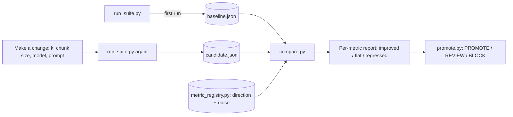

# Lecture 18 — Regression Testing for RAG: Preventing Silent Failures

> **Source lecture:** [RAG Regression Testing Explained: How to Prevent Silent AI Failures](https://www.youtube.com/watch?v=Aov5QczE3Vo) (CampusX)
> **What this note adds:** an intuitive explanation of noise vs real change, a worked standard-deviation example, a simple `compare.py` sketch, statistical caveats, and CI integration. ✏️ marks corrections, 🔎 marks extra material.

---

## 1. What "regression" means
> **Regression** (everyday English) = *"returning to a previous, less advanced or worse state."*

In software, a **regression** is when a change makes something that used to work **worse**.

**The classic trap:**
1. Recall is low (85%).
2. You raise k and add a reranker.
3. Recall rises to 90% 🎉 and you ship.
4. Meanwhile **precision dropped**, **contextual relevancy fell** and **latency rose**, but you were only watching recall.

> 💡 **Analogy:** a doctor raises your blood-pressure medicine and your BP improves, but nobody checks your kidneys. You need the **full health check-up** after every change.

**Regression testing** = after **every** change (k, chunk size, model, prompt, vector DB…), rerun the **entire eval suite** (~14 metrics), compare with a **baseline**, and deploy only if nothing meaningfully got worse.

This is an old software-engineering practice (e.g. migrating an API from Flask to FastAPI, then checking everything still works), applied to LLM apps.

> ⚠️ **Disclaimer:** the lecture builds it by hand for understanding. Companies use tools (MLflow, Confident AI, etc.). The **concepts transfer**; the execution differs.

---

## 2. The five-step process



1. **One script runs everything** (`run_suite.py`): quality, safety and ops evals in sequence.
2. **First run → `baseline.json`**: the "before" snapshot of ~14 metrics.
3. **Make a change.**
4. **Re-run → `candidate.json`**: the "after" snapshot.
5. **Compare (`compare.py`)**: per-metric **delta** (after − before).

---

## 3. Two complications, and their fixes

### Complication 1: "better" means different things for different metrics
| Higher is better ⬆️ | Lower is better ⬇️ |
|---|---|
| Faithfulness, recall, precision, answer relevancy, correctness… | **Latency, cost**, (toxicity, in the "toxic share" convention) |

A latency delta of +0.5 s is **bad**, while a faithfulness delta of +0.05 is **good**. So each metric needs a stored **direction**.

🔎 A neat trick (raised by a student): store direction as **+1 / −1** and compute `signed_delta = direction × (candidate − baseline)`. Positive then always means "improved".

### Complication 2: noise (scores move even when nothing changed)
Most quality and safety metrics use an **LLM judge**, and LLMs are probabilistic. Run the **same** system twice and precision might be 85.6 one time and 84.8 the next. A naive comparison would raise a **false alarm**.

**Fix: measure the noise, then ignore changes smaller than it.**
1. Run the baseline **5–10 times** with **no changes**.
2. For each metric, compute the **standard deviation (σ)**, a measure of how much the values wobble.
3. Set the **noise threshold = 2σ** (a safety margin).
4. A change smaller than the threshold is **noise**; a bigger change is **real**.

🔎 **Worked example (recall, 5 baseline runs):** 90.0, 90.8, 89.7, 90.4, 89.6
- Mean = 90.1
- σ ≈ 0.49
- **Threshold = 2σ ≈ 1.0**

| New recall | Change | Verdict |
|---|---|---|
| 89.5 | −0.6 | Within ±1, so **noise** (flat) |
| 87.5 | −2.6 | Beyond 1, so **regression** ❌ |
| 92.0 | +1.9 | Beyond 1, so **improvement** ✅ |

> 💡 **Why 2σ?** For roughly bell-shaped noise, about 95% of purely random wobbles fall within ±2σ of the mean. A bigger move is unlikely to be chance.

Both pieces of information (**direction** and **noise tolerance**) are stored per metric in **`metric_registry.py`**.

✏️ **Caveat about the demo:** the instructor ran the baseline only **twice** (to save time and money). A standard deviation from two values is very unreliable. Use **at least 5–10 runs** in practice.

⚠️ **Tiny golden datasets cause big swings.** With 5–15 rows, one test case is 7–20% of the score (e.g. PII leakage jumping between 60% and 80%). **Bigger datasets mean more stable metrics and smaller noise thresholds.**

---

## 4. Code organisation

| File | Role |
|---|---|
| `evals/eval_ops.py` | Merges `eval_latency`, `eval_cost`, `eval_reliability` |
| `evals/eval_safety.py` | Merges `eval_leakage`, `eval_toxicity`, `eval_scope` |
| `eval_retriever.py`, `eval_generator.py`, `eval_rag_pipeline.py`, `eval_application.py` | Quality evals refactored to expose a **`run()` function** (+ `if __name__ == "__main__":`), so they can be called from another script |
| `harness.py` | Standardises the four quality evals' inputs and outputs (same format) |
| `run_suite.py` | Runs all **6 eval groups**; writes `baseline.json` (first run) or `candidate.json`; accepts a label for the change (e.g. "chunk 500 / overlap 100") |
| `metric_registry.py` | Direction + noise tolerance per metric |
| `compare.py` | Labels each metric improved / flat / regressed |
| `promote.py` | Optional decision rules: PROMOTE / REVIEW / BLOCK |

(The individual eval files are kept for readability; delete them for a cleaner repo.)

### 🔎 A minimal `compare.py` sketch
```python
import json
from metric_registry import REGISTRY   # {"recall": {"direction": +1, "noise": 1.0}, "latency_p95": {"direction": -1, "noise": 0.3}, ...}

base = json.load(open("baseline.json"))
cand = json.load(open("candidate.json"))

for name, cfg in REGISTRY.items():
    delta = cfg["direction"] * (cand[name] - base[name])   # positive = better
    if abs(delta) <= cfg["noise"]:
        status = "flat (within noise)"
    elif delta > 0:
        status = "IMPROVED"
    else:
        status = "REGRESSED"
    print(f"{name:25s} {base[name]:>8.3f} -> {cand[name]:>8.3f}  {status}")
```

### Decision tiers (`promote.py`)

| Tier | Metrics (example) | If it regresses |
|---|---|---|
| **Critical** | Safety (PII leakage, toxicity), correctness | **BLOCK** |
| **Important** | Contextual relevancy, latency | **REVIEW** (a human weighs the trade-offs) |
| **Minor** | Style | Allowed |

The tiers are application-specific; the lecture defines its own logic.

---

## 5. The demo

**Change:** `chunk_size` 1500 → **500**, `chunk_overlap` → **100**. Goal: raise contextual relevancy (~43–45%), following the advice from lecture 14 to use smaller chunks. Delete Chroma and re-embed.

**Run:** `run_suite.py` executes 6 eval groups (retriever: recall 96 / precision 90 → generator → triad → application → safety → ops).
- It takes **~5+ minutes**.
- It costs **~₹25–30 per run**, even with tiny datasets. Larger datasets cost proportionally more, so evaluation itself needs a budget.

**`compare.py all` output:**
- **Most metrics flat** (within noise)
- **~4–5 improved**
- **2 regressed:**
  - **Contextual relevancy ≈ 45 → 38**. Ironically, the very metric the change was meant to improve.
  - **PII leakage**: the score dropped by roughly 20%, a serious **safety red flag**.

**`promote.py` verdict: BLOCK** (a critical safety metric fell). If only contextual relevancy had dropped, the verdict would be **REVIEW**: humans weigh one regression against five improvements.

> 💡 **Lesson:** intuitions ("smaller chunks will fix relevancy") are hypotheses. Regression testing is how you **check** them, and it caught an unexpected safety side-effect.

---

## 6. Q&A highlights

| Question | Answer |
|---|---|
| How do I tell whether a bad answer comes from retrieval or generation? | Read the metrics together. Good recall, precision and contextual relevancy plus a bad answer points to the **generator**. A retriever metric moved: the **retriever**. |
| The suite is slow. Is that a problem in CI? | It's acceptable. Deployment can wait; only the best version should ship. |
| Is this "local CI"? | Yes. Put it in **GitHub Actions** and it becomes CI. In production, regression testing is a stage *inside* CI. |
| Can we combine everything into one score? | Possible with domain-specific weights, but generally **not done**. Each metric describes a different aspect, and averaging hides problems (a safety drop could be masked by style gains). |
| How rigorous should noise thresholds be? | Use 5–10+ baseline runs. Serious setups use statistics: **confidence intervals, significance tests (p-values), hypothesis testing**. At ChatGPT scale this is a specialist field. |

🔎 *Beyond the lecture: making comparisons fairer*
- **Paired comparison:** compare the baseline and candidate on the **same test cases**, case by case. Count how many cases flipped from pass to fail and vice versa. This is more sensitive than comparing two averages.
- **Bootstrap confidence intervals:** resample your test cases many times to estimate a range for each metric. If the baseline and candidate ranges overlap heavily, the difference may not be real.
- **Fix the judge model and its settings** between runs. Changing the judge changes the "ruler".

### 🔎 CI integration sketch (GitHub Actions)
```yaml
name: eval-gate
on: [pull_request]
jobs:
  evals:
    runs-on: ubuntu-latest
    steps:
      - uses: actions/checkout@v4
      - run: pip install -r requirements.txt
      - run: python -m evals.run_suite --out candidate.json
        env: { OPENAI_API_KEY: ${{ secrets.OPENAI_API_KEY }} }
      - run: python -m evals.compare baseline.json candidate.json
      - run: python -m evals.promote   # exits non-zero on BLOCK, which fails the PR check
```

---

## 7. Quick revision
- Regression testing = **full suite on every change**, compared with a **baseline**.
- **Metric registry** = direction (± 1) + noise tolerance (≈ 2σ from repeated baseline runs).
- **compare.py** gives improved / flat / regressed. **promote.py** gives PROMOTE / REVIEW / BLOCK.
- Small datasets produce noisy metrics. Evals cost money.
- The demo: a "fix" for contextual relevancy made it worse **and** hurt safety, so it was blocked.

### Self-test
1. Why can't you compare a single baseline run with a single candidate run for LLM-judged metrics?
2. Latency rose from 2.1 s to 2.4 s with a noise tolerance of 0.5 s. Verdict?
3. Why might a team refuse to collapse all metrics into one composite score?

<details><summary>Answers</summary>

1. Judge noise makes scores vary even with no change, so you'd mistake noise for regression or improvement.
2. +0.3 s is within ±0.5 s, so it's **flat** (noise).
3. A drop in a critical metric (e.g. safety) could be hidden by gains elsewhere.
</details>
