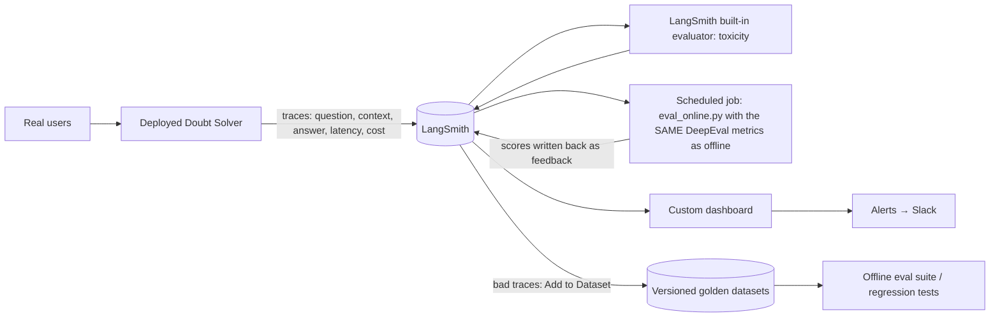
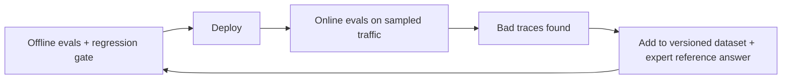

# Lecture 19 — Online RAG Evaluation: Monitoring in Production with LangSmith

> **Source lecture:** [Online RAG Evaluation: Monitoring Production LLMs with LangSmith (Code Demo)](https://www.youtube.com/watch?v=wON2L2ZvKpE) (CampusX)
> **What this note adds:** an architecture diagram, how LangSmith's automation rules filter and sample (from the official docs), why identical evaluators matter, a scheduled-job sketch, and production tips. ✏️ marks clarifications, 🔎 marks extra material.

---

## 1. The big picture



After deployment you **keep evaluating**. But new user questions have **no answer key**, so **only reference-free metrics can run online**.

---

## 2. Which offline metrics can run online?

| Level | Metric | Needs a reference? | Online? |
|---|---|---|---|
| Retriever | Contextual recall | ✅ (ideal answer) | ❌ |
| Retriever | Contextual precision | ✅ | ❌ |
| Generator / pipeline | **Faithfulness** | ❌ (answer vs context) | ✅ |
| Generator / pipeline | **Answer relevancy** | ❌ | ✅ |
| Pipeline | **Contextual relevancy** | ❌ | ✅ |
| Application | Correctness | ✅ (correct answer) | ❌ |
| Application | Completeness | ✅ | ❌ |
| Application | Style | ❌ | ✅ (skipped: style rarely drifts) |
| Safety | **Scope, leakage, toxicity** | ❌ (mostly) | ✅ (toxicity demoed) |
| Ops | **Latency, cost**, reliability | ❌ (measured, not judged) | ✅ (reliability needs Grafana/Prometheus, out of scope) |

**The online suite in this lecture (6 metrics):** contextual relevancy, faithfulness, answer relevancy, toxicity, latency, cost.

> 🔎 **Proxy for correctness online:** user feedback (thumbs up/down), escalations and re-asked questions (lecture 6).

---

## 3. Step 1: Connect the app to LangSmith (ops metrics come for free)

**What is tracing?** A **trace** is a recorded timeline of one request: every step (retrieval, prompt, LLM call, parsing) with its inputs, outputs, time and cost. Think of it as a **flight recorder** for your app.

### Setup
1. Go to **smith.langchain.com** → Tracing → create a project (**"CX Doubt Solver"**) and an **API key**.
2. Add these to `.env`:
   ```
   LANGSMITH_TRACING=true
   LANGSMITH_ENDPOINT=https://api.smith.langchain.com
   LANGSMITH_API_KEY=...
   LANGSMITH_PROJECT=CX Doubt Solver
   ```
   and install the SDK: `uv add langsmith`.
3. Run `python -m src.rag_pipeline` ("What is GSM8K?"). The trace appears automatically with the question, context, answer, **latency (4.14 s)** and **cost ($0.0004)**.

Tracing is **asynchronous** (sent in the background), so it doesn't add noticeable latency.

### Problem: retrieval wasn't in the trace
The automatic trace showed only `ChatPromptTemplate → ChatOpenAI → StrOutputParser`. **Retrieval and reranking were missing**, so latency was **understated**.

**Fix:** add the `@traceable` decorator to the steps you want recorded.
```python
from langsmith import traceable

class RAGPipeline:
    @traceable(name="rag_pipeline")
    def invoke(self, question): ...

class RerankingRetriever:
    @traceable(name="retriever")
    def invoke(self, question): ...
```
- The trace now shows `rag_pipeline → retriever → prompt → LLM → parser`.
- Latency rises to **4.79 s**: it now includes retrieval.

**Rules of thumb:**
- If a step isn't traced automatically, **decorate it**.
- Nested decorators form a **tree** (parent → child spans). No duplicates are created.

Then run ~8 different questions to **simulate real traffic** (MMLU, why evals, model vs application evals, benchmarks…).

---

## 4. Step 2: Dashboard and alerts

### Custom dashboard
**Monitoring → Custom → New dashboard** ("CX Doubt Solver Dashboard"). The prebuilt dashboard is ignored in the lecture.

| Chart | Settings | Why |
|---|---|---|
| **Latency P95** | Metric: latency · aggregation: percentile 95 | Watch the tail (slow users) |
| **Average cost** | Metric: total cost (or input/output separately) · aggregation: average | Cost per answer, not the total spend |
| Toxicity (later) | Feedback: toxicity · average | Safety trend |
| Answer relevancy / faithfulness / contextual relevancy (later) | Feedback key · average (or min/percentile) | Quality trend |

The time window can be switched (1 h / 3 h / 6 h / 30 days).

### Alerts
- **Example:** "If latency > 7–8 s over the last 60 minutes → message Slack." Another: "If total LLM cost > $5 in the last 60 minutes → alert."
- ✏️ At recording time, the latency alert in the LangSmith UI offered only **average** latency, not P95. The instructor's guess was that P95 reflects outliers while alerts target population-wide problems. **Product UIs change, so check the current docs.**
- **How sensitive should thresholds be?** They come from your **SLO** (lecture 17), which is a **business decision**. A research assistant may legitimately take a minute; a live-match Q&A bot may not.

---

## 5. Step 3: Online safety with LangSmith's built-in toxicity evaluator

**Two options:**
1. Reuse your offline DeepEval evaluator (via a scheduled job, as in step 4).
2. Use a **LangSmith online evaluator** (built-ins include PII leakage, prompt injection, toxicity, bias/fairness, all reference-free LLM-as-judge).

The lecture uses option 2 for toxicity, to demonstrate the feature (and because a large vendor's evaluator is likely to be good).

### Configuration
- Name and application: auto-filled.
- **Judge model:** the default was a GPT-5.x model; any provider can be chosen.
- **System prompt:** editable (left as is).
- **Run on: Tracing** (= online). Datasets would make it offline.
- **Sampling rate:** how many traces get evaluated.
  - 100% = every trace. 50,000 traces a day means 50,000 judge calls, which is expensive.
  - In production, sample (e.g. **30%**), sized to your budget. A large random sample **estimates** the whole population well.
- Provide your **OpenAI API key** (you pay for the judge).

🔎 **How LangSmith rules actually work** (official docs): an automation rule = **filter** (which runs qualify) + **sampling rate** (a fraction of the filtered runs, 0–1) + **action** (e.g. run an evaluator). You can also apply rules to past runs. [Online evaluations: LLM-as-judge](https://docs.langchain.com/langsmith/online-evaluations-llm-as-judge) · [Rules](https://docs.langchain.com/langsmith/rules). This makes **stratified sampling** easy: e.g. evaluate *all* thumbs-down traces, plus 10% of the rest.

### Result
"What are LLM leaderboards?" gets **toxicity 0**, with the reason "explanatory and professional; no personal attacks". Feedback appears after **~2–3 minutes** (evaluation runs asynchronously). New feedback keys can take a while to appear in the chart menus.

**Q&A:** it evaluates the **system's output**, not the user's input. ("You can't stop users from typing anything.")

---

## 6. Step 4: Online quality, using the same evaluators as offline

### Why the evaluators must be identical
> If offline you measured contextual relevancy with **DeepEval** (score 45) and online with **LangSmith's evaluator** (score 55), you **cannot compare** them. The tools use different prompts, definitions and calculations.
> With the **same evaluator, judge model and thresholds** online, 45 offline → 38 online genuinely means **worse in production**.

> 💡 **Analogy:** measure your height at the clinic in centimetres and at home in inches, and you can't tell whether you've grown.

(Strictly, the same logic applies to toxicity too. LangSmith's evaluator was used there only to show the feature.)

### Architecture
- The deployed app (e.g. on AWS) plus a **scheduled background job** (a **cron job**, i.e. a task that runs on a timetable, e.g. every 5 minutes) that triggers `evals/eval_online.py`.
- **Each run of the job:**
  1. Use the **LangSmith SDK** to fetch traces from the last N minutes (respecting the sample rate).
  2. Run the **DeepEval** metrics on each trace: faithfulness, answer relevancy, contextual relevancy.
  3. **Write the scores back** to LangSmith as **feedback** on each trace.
- The offline eval files read the **golden dataset**; online, you read **traces**. So a separate file is needed, but it uses the **same metric objects**.

### 🔎 Sketch of `eval_online.py`
```python
import time
from datetime import datetime, timedelta, timezone
from langsmith import Client
from deepeval.test_case import LLMTestCase
from deepeval.metrics import FaithfulnessMetric, AnswerRelevancyMetric, ContextualRelevancyMetric

client = Client()
PROJECT = "CX Doubt Solver"
metrics = {
    "faithfulness": FaithfulnessMetric(model="gpt-4o-mini", threshold=0.7),
    "answer_relevancy": AnswerRelevancyMetric(model="gpt-4o-mini", threshold=0.7),
    "contextual_relevancy": ContextualRelevancyMetric(model="gpt-4o-mini", threshold=0.7),
}

def score_recent_traces(minutes=1):
    since = datetime.now(timezone.utc) - timedelta(minutes=minutes)
    for run in client.list_runs(project_name=PROJECT, is_root=True, start_time=since):
        q, a, ctx = extract_question_answer_context(run)      # app-specific helper
        case = LLMTestCase(input=q, actual_output=a, retrieval_context=ctx)
        for key, metric in metrics.items():
            metric.measure(case)
            client.create_feedback(run.id, key=key, score=metric.score, comment=metric.reason)

while True:              # demo only; use cron / a scheduler in production
    score_recent_traces()
    time.sleep(60)
```
*(The function names follow the LangSmith and DeepEval SDKs, but check the current signatures. `extract_question_answer_context` depends on how your traces are structured.)*

### Demo results (per trace; feedback lags a little)
| Question | Answer relevancy | Contextual relevancy | Faithfulness | Toxicity |
|---|---|---|---|---|
| "What are golden datasets?" | 0.92 | **0.23** | 0.75 | 0 |
| "Why do we need golden datasets?" | 1.0 | **0.29** | 1.0 | 0 |

Contextual relevancy is low online too, consistent with the noisy-chunk finding in lecture 14. Add a dashboard chart and an **alert** for each metric.

### 🔎 Production tips
- Use a **real scheduler** (cron, a cloud scheduler, a task queue), not an infinite loop in a terminal (it stops when the terminal closes).
- **Track which traces have been scored**, so nothing is scored twice or skipped (e.g. keep a "last processed" timestamp).
- **Budget the judge cost:** sampling rate × traffic × metrics × price per judge call.
- **Mask PII before sending traces** to a third-party judge (lecture 6).

---

## 7. Step 5: Close the loop with versioned datasets
1. A trace scores badly (low relevancy, low faithfulness…).
2. Click **"Add to Dataset"** (create one from scratch and define its input/output schema).
3. Have an **expert write the correct reference answer**, so the example can power **reference-based** offline metrics (correctness, completeness).
4. Re-run offline evals and regression tests on the enriched dataset.

**Better practice: keep all golden datasets in LangSmith from day one.**
- A **single source** for offline and online evaluation.
- One click from a bad trace to a new dataset example.
- **Versioning and rollback** ("show me the golden set from 6 months ago").
- Load them into offline evals via the **SDK**.

This is how production teams link offline and online evaluation.



---

## 8. Wrap-up: the full RAG evaluation story
| Stage | Lectures |
|---|---|
| Framework | 12 |
| Component level (retriever, generator) | 13, 14 |
| Pipeline level (RAG triad) | 14 |
| Application quality (G-Eval) | 15 |
| Safety | 16 |
| Ops | 17 |
| Regression testing | 18 |
| Online monitoring + feedback loop | 19 |

- The concepts transfer to any tool (LangSmith, Langfuse, Confident AI, Arize Phoenix…).
- **Next:** agent evaluation, which should go faster now that the fundamentals are in place.

### Self-test
1. Why can't contextual recall run online?
2. Why must the online faithfulness evaluator be identical to the offline one?
3. Your app gets 40,000 traces/day. You run 3 judged metrics at a 25% sampling rate. How many judge evaluations per day?

<details><summary>Answers</summary>

1. It needs an ideal (reference) answer, and new user questions don't have one.
2. So the scores are on the same scale and offline vs online numbers can be compared meaningfully.
3. 40,000 × 0.25 × 3 = **30,000** metric evaluations per day (each may involve several LLM calls).
</details>
